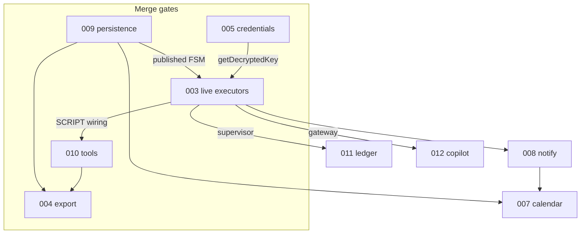
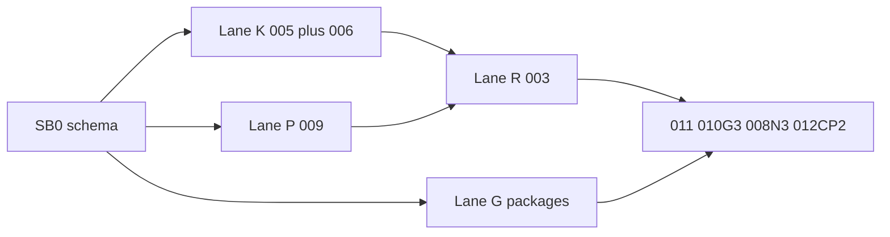

# 000 — Completion Roadmap (v1)

> Status: **Living** — update whenever a feature doc changes status
> Relates to: [DETAILED_DESIGN_PLAN.md §16](../DETAILED_DESIGN_PLAN.md)
> Owns: sequencing, dependencies, and the definition of done for v1

---

## What

The single ordered plan that takes the project from **"canvas authoring works"** to **"v1 complete"**: every remaining FeatureShipping doc, in dependency order, with the test bar each must clear.

## Why

Feature 001 shipped the authoring surface, but the product's five headline promises are only one-fifth real. Everything downstream of authoring — running, securing, optimizing, exporting — is either stubbed or missing, and the stubs are scattered across nine documents with no agreed order. This doc is the sequencing contract so parallel `ship-feature` sessions never block each other.

## How

**Waves are merge-gates, not start-gates.** A wave describes when a *capability* becomes true for everything downstream. Most phases can start the same day on isolated files; only a short list of merge points actually serialize work.

Parallel execution is the default. See §8 for lanes, file ownership, and the kickoff that unblocks four concurrent `ship-feature` sessions.

---

## 1. Where we actually are

| Subsystem | Real today | Stubbed / missing |
|-----------|-----------|-------------------|
| FSM orchestration ([`packages/fsm-engine`](../packages/fsm-engine)) | Signal parsing, transitions, mask/rewire, guardrails, spawn pool | — |
| State executors | — | All of them: [`stubExecute`](../apps/web/src/lib/run-engine.ts) returns a fixed success signal per state type |
| Canvas persistence | Authoring, lint, DSL emit | **Canvas lives only in `localStorage`** (`fsm-canvas-store`); no server record, no versions |
| Runs | Blocking POST writes `runs` + `run_events` | No streaming, no retry in practice, run history UI is `MOCK_RUNS` |
| Credentials | Live provider discovery + SSRF guard | Keys sit in `localStorage`; DB `credentials` table never written |
| Memory | Graph CRUD + visualization + M1 indexer | Book/TOC graph (CAG), RAG by intent/identity, studio Code-book layer |
| Export | `fsm.json` browser download | ZIP, compose codegen, git push, `export_jobs` |
| Tools (C++/Python/Bash over gRPC) | — | Entire runtime; `packages/proto`, `packages/grpc-bridge` absent |
| Token optimization | Authoring of State 0 / SYS_FUNC | No runtime hydration, no ledger; `tokensIn/out/latencyMs` never populated |
| Copilot | Panel UI | Keyword matching, self-described "stub mode" |
| Calendar / Notifications | Bento tiles | Everything (`cta="Soon"`) |
| CI | Typecheck + Vitest | Lint non-blocking (17 errors), Playwright disabled |

## 2. Dependency graph



Arrows mean the *consuming phase* waits, not the whole document. `010 G1` (proto + fake server) does not wait for 003; `010 G3` (SCRIPT executor) does. Same pattern on 004, 007, 008, 012.

## 3. Waves (merge gates)

Use this table to know when a *capability* is online. Do **not** use it as a start-order — see §8.

| Wave | Docs | Gate to exit |
|------|------|--------------|
| **0 — Foundation** | [009](009-canvas-persistence.md), [005](005-credential-security.md), [006](006-ci-pipeline.md) | Server is the source of truth for FSMs; no plaintext key leaves the server; CI gates lint + unit + E2E |
| **1 — Live runtime** | [003](003-live-executors.md), [011](011-token-and-observability.md), [008](008-notifications.md) | A real AI + HTTP workflow runs end to end, streams events, records tokens, and notifies on completion |
| **2 — Determinism** | [010](010-tool-runtime-grpc.md) | A `SCRIPT` state executes real Python/Bash over gRPC in a sandboxed container |
| **3 — Distribution** | [004](004-harness-export.md) | Exported bundle boots via `docker compose up` and completes a fixture FSM |
| **4 — Product shell** | [007](007-calendar.md), [012](012-copilot.md) | No `cta="Soon"` tiles remain; copilot edits the canvas through validated ops |
| **Anytime** | [002](002-memory-and-code-index.md) | Graph + **book (RAG+CAG)** memory: TOC graph, intent/identity navigation; M5 TOC feeds 011 |
| **5 — FSM contract** | [013](013-state-signal-catalog.md), [014](014-run-contract.md) | Palette is segregated; custom states/signals have a procedure; runs retry, verify, resume, deny tools, and drop per-state memory |

## 4. Definition of done (v1)

The README makes five promises. v1 is complete when each is demonstrably real, covered by tests, and green in CI:

| Promise | Done when | Doc |
|---------|-----------|-----|
| FSM-native workflows | Authored FSM persists server-side and replays deterministically | 001 ✅, 009 |
| Deterministic ≠ generative | `SCRIPT` runs native tools over gRPC; `AI` runs a real model | 010, 003 |
| Flat token cost at depth | State 0 hydration + SYS_FUNC checkpoints run at runtime with a measured ledger | 011 |
| Visual authoring | Copilot mutates the canvas via Zod-validated ops; no stub mode | 012 |
| Exportable harnesses | `docker compose up` on an exported bundle completes a fixture run | 004 |

Plus: zero `Soon` tiles (007, 008), credentials encrypted at rest (005), CI enforcing lint + unit + E2E (006), segregated FSM catalog with a signal/state registration procedure (013), and a run contract for retry / verify / resume / tool grants / per-state memory (014).

## 5. Test bar (applies to every doc)

Each feature doc carries its own **Test plan** section. The shared rules:

1. **Vitest** covers pure logic — DSL/schema shapes, executors with injected `fetch`/provider, crypto envelopes, cron math, reducers. No DB, no network.
2. **Playwright** covers one user-visible path per phase, against `FSM_MOCK_PROVIDER=1` so no real key or spend is needed in CI.
3. **Determinism**: any codegen or hashing gets a golden-snapshot test.
4. A phase is not **Shipped** until its acceptance-criteria checkboxes are ticked and CI is green — see [006](006-ci-pipeline.md).

## 6. Locked decisions

Resolving these unblocks the docs below; each is recorded again in the owning doc.

| Ref | Question | Decision | Owner doc |
|-----|----------|----------|-----------|
| Q2 | Accounts from day one? | **No** — single-user local/self-hosted for v1; schema keeps nullable `projectId` scoping so accounts can be added later | 009 |
| Q1 | tRPC or REST? | **Next server actions + REST route handlers** — no new RPC layer in v1 | 009 |
| Q21 | Autosave or explicit save? | **Debounced autosave** for the draft, **explicit publish** for immutable versions | 009 |
| Q3 | Harness versioning | **Content hash** on every published version; semver only on export manifests | 009, 004 |
| Q15 | Key management | **`PLATFORM_SECRET` + AES-256-GCM** now; KMS deferred | 005 |
| — | Run transport | **SSE** with replay from `run_events` by `lastEventId` | 003 |
| Q14 | Launch providers | OpenAI, OpenAI-compatible, Anthropic; Ollama via the OpenAI-compatible adapter | 003 |
| Q10 | Human-in-the-loop | **v1** — real pause/resume, not auto-approve | 003 |
| Q12 | Budget `onExceed` | Default **halt**, per-project override to `degrade` or `notify` | 011 |
| Q11 | Hydration summary | Default **`template`** (free); `llm` opt-in per SYS_FUNC | 011 |
| Q19 | Tool egress | **Default-deny** with per-harness allowlist | 010 |
| Q24 | Git export auth | **User PAT**, stored through the 005 envelope | 004 |
| Q29 | Memory in exports | **Opt-in** `memory.json` snapshot; off by default | 004 |
| Q23 | K8s/Helm targets | **v2** — ZIP and git only in v1 | 004 |
| Q5 | Custom `::MYAPP.*` signals | **Allowed**. Reserved namespaces (`SCRIPT` `HTTP` `VALIDATE` `AI` `EXTERNAL_AI` `HUMAN` `SPAWN` `SYSTEM` `STATE` `TRANSITION`) cannot be registered. Exact-string uniqueness. | 013 |
| Q31 | Palette groups | **Five**: Flow, Work, Generative, Control, Custom. Work is deterministic only. | 013 |
| Q32 | New built-in types in this wave | **None**. Custom types reuse SCRIPT/HTTP/AI/`none` executors. `ERR` is `END` with `terminal: "error"`. | 013 |
| Q33 | START default signal | **`::STATE.SUCCESS`** (legacy `::SCRIPT.NEXT` edges still run; lint warns) | 013 |
| Q34 | Lifecycle edges | Engine always records `::STATE.*` / `::TRANSITION.*` as events. Authoring them as edges is optional; `ENTER`/`EXIT`/`RETRY` lint-warn. | 013 |
| Q35 | Denied tool vs AI | **Stop the AI turn**. Emit `::AI.TOOL_DENIED`. Do not continue chatting after a deny. | 014 |
| Q36 | Resume unit | **Last completed state**. Re-enter `nextStateId` with that state's output payload only. | 014 |
| Q37 | Judge model | **Separate BYOK credential/model** from the worker. Fail closed on judge error. Default success condition is `signal` (no extra call). | 014 |
| Q38 | Retry vs self-loop | **Independent**. `retryMax` is executor attempts; `maxIterations` is taken self-loop edges. | 014 |
| Q39 | Per-state memory | **Drop history after success** (default). `retainContext: true` opt-in. SYS_FUNC dehydrate still wins at cluster boundaries. | 014 |
| Q40 | Schema for cursor | **No new tables**. Cursor is `run_events.kind = "run.cursor"`. | 014 |
| Q41 | Memory address | **Intent + identity only**. Never use full file bodies as the retrieval key. | 002 |
| Q42 | RAG vs CAG | **CAG** = TOC graph + per-file summaries always available (token-capped). **RAG** = fetch symbol cards by intent/identity/`expandNeighbors`. | 002 |
| Q43 | Code memory UI | **Graphical** (React Flow dir/file/symbol), not table-only. Facts graph stays. | 002 |

Still open (do not block Wave 0–5): Q4 meta-cognitive auto-apply, Q17 mixed tool languages, Q28 Turso tier, Q30 script-template sharing.

## 7. Working agreement

- Detail with **detail-feature** (high-end model) → implement **one phase** with **ship-feature** (Composer/Grok) → cover with **test-feature** (Composer/Grok).
- One phase per PR, branch `cursor/<short-feature-slug>`, base `master`. Rebase onto `master` before opening the PR.
- Update the status line in the feature doc and the index row in [README.md](README.md) in the same PR that ships a phase.
- Never edit a file another live lane owns (see §8.2). If you must, stop and land that lane's PR first.
- Schema changes go through the bootstrap PR or a single follow-up migration PR — never two open PRs that both edit [`apps/web/src/db/schema.ts`](../apps/web/src/db/schema.ts).

---

## 8. Parallel execution

### 8.1 Why waves over-serialize

| Assumed wait | Reality |
|--------------|---------|
| 010 waits for 003 | Only G3 (SCRIPT executor) needs the supervisor. G1 proto + G2 runtimes are greenfield packages. |
| 004 waits for 009 + 010 | Only X2 (ZIP of a published version) and X4 (compose smoke) wait. X1 `generateHarness` is a pure function over fixture DSLs. |
| 012 waits for 003 | Only CP2 (gateway call) waits. CP1 schema + reducer + layout is canvas-only. |
| 006 waits for anything | Lint cleanup and job split touch CI + nine already-failing files. They unblock Playwright for everyone else. |
| 003 waits for 005 | Mock adapter (`FSM_MOCK_PROVIDER=1`) ships first; live keys wire in E4 after 005 lands. |
| 003 waits for 009 | E1 can keep inserting a snapshot per run (today's behavior). Switch to published `fsmId` in a follow-up once 009 P3 exists. |
| 008 / 007 wait for 003 | N1 / Cal1 are schema + pure cron math. Emission and the ticker wait. |

The real serializer is **`schema.ts` + `run-supervisor.ts`**, not the feature list.

### 8.2 File ownership (do not cross)

| Hot file | Owner lane | Everyone else |
|----------|------------|---------------|
| [`apps/web/src/db/schema.ts`](../apps/web/src/db/schema.ts) + `migrations/` | **SB0** then closed | Consume the tables; do not add columns in feature PRs |
| [`apps/web/src/lib/run-engine.ts`](../apps/web/src/lib/run-engine.ts) → `run-supervisor.ts` | **Lane R** (003) | Dependents (011, 010 G3, 008 N3, 007 Cal3) rebase after E1 merges |
| [`apps/web/src/stores/canvas-store.ts`](../apps/web/src/stores/canvas-store.ts) | **Lane P** (009), then **Lane C** (012 CP3) | 012 CP1 must not touch the store — reducer is a pure function of `CanvasData` |
| [`apps/web/src/components/runs/runs-view.tsx`](../apps/web/src/components/runs/runs-view.tsx) | **Lane P** (009 P4) then **Lane R** (003 E2) | 011/008 add panels in follow-ups, not in the first PR |
| [`.github/workflows/ci.yml`](../.github/workflows/ci.yml) | **Lane Q** (006) | 010 G5 and 004 X4 add jobs only after CI3 |
| New packages (`byok-gateway`, `proto`, `grpc-bridge`, `export-engine`, `fsm-schema`, `runtimes/*`) | The lane that creates them | No overlap by construction |

### 8.3 Kickoff: schema bootstrap (SB0)

One Composer/Grok PR, landed **before** the four lanes fan out. Adds every table the Detailed docs already specified, unused until a later phase wires them:

| Table / columns | For |
|-----------------|-----|
| `fsm_drafts`; `fsm_definitions.content_hash`, `label`; unique `(project_id, version)` | 009 |
| `credentials.last4`, `active`, `models_json`, discovery columns, `revoked_at` | 005 |
| `code_symbols` | 002 |
| `notifications` | 008 |
| `schedules`; `runs.triggered_by`, `runs.schedule_id` | 007 |
| `human_tasks`; `runs.status` values `awaiting_human` / `cancelled` / `interrupted` | 003 |
| `checkpoints` | 011 |
| `export_jobs.content_hash`, `size_bytes`, `error` | 004 |

No UI, no executors. Vitest: Drizzle schema round-trip + a migration that applies cleanly on an empty libSQL file.

After SB0 merges, **four agents start the same day** and never touch `schema.ts`.

### 8.4 Four lanes



Sequence, not calendar. Lane R starts once SB0 + 005 S2 exist so `getDecryptedKey` compiles; E1 still runs under `FSM_MOCK_PROVIDER=1` if keys are not fully wired.

| Lane | First four `ship-feature` prompts | Owns |
|------|-----------------------------------|------|
| **P — Persistence** | 009 P1 actions → P2 autosave → P3 versions → P4 run history | canvas-store, project actions, toolbar, version dialog, runs-view history |
| **K — Keys + CI** | 005 S2 envelope (no schema) + 006 CI2a in parallel, then 005 S3, then 006 CI2b/CI3 | envelope.ts, credential actions/UI, ci.yml, the 17 lint-error files |
| **G — Greenfield** | Four *simultaneous* PRs: 010 G1, 004 X1, 012 CP1, 002 M1 | new packages only + `code-index/actions.ts` (tables already in SB0) |
| **R — Runtime** | 003 E1 (after 005 S2) → E2 → then 011 T1 and 010 G3 in parallel | byok-gateway, run-supervisor, executors, SSE |

### 8.5 What four agents do *today* (no merge wait except SB0)

After SB0:

1. `ship-feature` **009 P1** — draft/publish actions against the new tables.
2. `ship-feature` **005 S2** — `envelope.ts` + server CRUD + discover-by-`credentialId`.
3. `ship-feature` **010 G1** — `packages/proto` + `packages/grpc-bridge` + fake server tests.
4. `ship-feature` **006 CI2a** — mechanical lint cleanup (unblocks making lint required).

Overflow (also start-now, pick if a fifth agent is free): **004 X1**, **012 CP1**, **002 M1**, **008 N1** (`notify()` + actions; table already exists).

### 8.6 Second fan-out (after 003 E1 merges)

These four become unblocked together:

| Agent | Phase | Why it waited |
|-------|-------|----------------|
| 1 | 003 E2 HTTP + VALIDATE + live runs UI | Needs the supervisor |
| 2 | 011 T1 phase map | Needs a real AI call to inject into |
| 3 | 010 G3 SCRIPT executor | Needs `executeState` registry |
| 4 | 008 N3 + 012 CP2 | Emission points and gateway |

007 Cal3 (ticker) waits for both 003 E1 and 009 P3 (a published version to fire). 004 X2 waits for 009 P3. 004 X4 waits for 010 G2 images.

### 8.7 Merge order inside a lane

Lanes merge to `master` independently. The only required stacks:

```
SB0
 ├─ 009 P1 → P2 → P3 → P4
 ├─ 005 S2 → S3
 │    └─ 003 E1 → E2 → E3 → E4
 │         ├─ 011 T1 → T2 → T3 → T4
 │         ├─ 010 G3   (G1/G2 already on master)
 │         ├─ 008 N3   (N1/N2 already on master)
 │         └─ 012 CP2  (CP1 already on master)
 ├─ 006 CI2a → CI2b → CI3
 ├─ 010 G1 → G2 → G4 → G5
 ├─ 004 X1 → X2 (needs 009 P3) → X3 → X4 (needs 010 G2)
 ├─ 002 M1 → M2 → M3 → …
 └─ 013 F1 → F2
      └─ 014 libs ∥ 014 R1 engine
           └─ 014 supervisor wire (owns run-supervisor.ts; rebase onto E3+T2)
```

If two PRs collide, **the greenfield / test-only PR rebases**. Persistence and runtime PRs keep the contested file.

### 8.8 Suggested `ship-feature` invocation

Each agent gets exactly one phase. Prefer the project subagents in [`.cursor/agents/`](../.cursor/agents/README.md):

> Use **ship-dispatcher** to name the next jobs, then spawn **schema-bootstrap** / **lane-persistence** / **lane-keys-ci** / **lane-greenfield** / **lane-runtime**.

Copy-paste if invoking `ship-feature` directly:

> Implement FeatureShipping **&lt;NNN&gt;** phase **&lt;id&gt;** with `ship-feature`. Stay inside that phase's file map. Do not edit `schema.ts` (owned by SB0). Do not edit files listed under another lane in `000-completion-roadmap.md` §8.2. Follow with `test-feature` on the same branch.

### 8.9 Wave 5 kickoff (013 / 014)

After 001 authoring exists (true on `master`). Do **not** wait for 003 E4.

1. `ship-feature` **013 F1** then **F2** (palette, kits, registry procedure). Files: `fsm-types.ts`, `registry.ts`, inspector. No supervisor.
2. Parallel with F2: **014 libs** — new files only (`verify-success.ts`, `tool-grants.ts`, `run-context.ts`, `run-cursor.ts`) + Vitest.
3. Parallel: **014 R1** engine retry/lifecycle in `packages/fsm-engine` (no supervisor).
4. After 013 F1 types exist **and** a single Lane R agent holds `run-supervisor.ts`: wire R1–R5 in one PR (or stacked PRs on that branch).

Playwright for 014 needs `FSM_MOCK_PROVIDER=1` and live executors (003 E1+). Authoring E2E for 013 does not.

### 8.10 Memory book (002 B1–B3) — Grok 4.6

Anytime; does not wait on 013/014. Base on `origin/cursor/code-index-m1-1e9b` (M1 indexer).

1. **B1** `book-toc.ts` + Vitest (no UI).
2. **B2** `/memory` Code-book React Flow layer + Playwright (stacks on B1).
3. **B3** `expandNeighbors` + `formatTocForPrompt` for 011 (can ship with B1 if files do not collide).

Do not edit `schema.ts` or `run-supervisor.ts`. Use **Grok 4.6** only.
