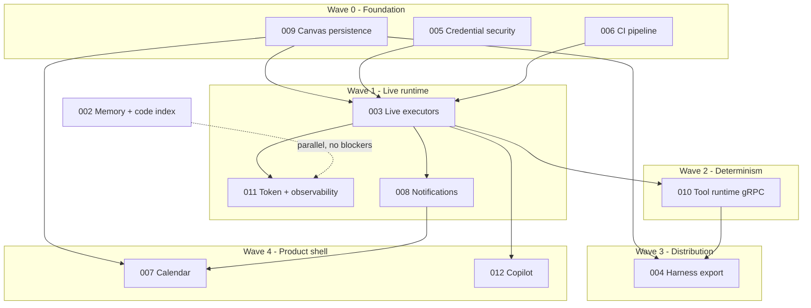

# 000 — Completion Roadmap (v1)

> Status: **Living** — update whenever a feature doc changes status
> Relates to: [DETAILED_DESIGN_PLAN.md §16](../DETAILED_DESIGN_PLAN.md)
> Owns: sequencing, dependencies, and the definition of done for v1

---

## What

The single ordered plan that takes the project from **"canvas authoring works"** to **"v1 complete"**: every remaining FeatureShipping doc, in dependency order, with the test bar each must clear.

## Why

Feature 001 shipped the authoring surface, but the product's five headline promises are only one-fifth real. Everything downstream of authoring — running, securing, optimizing, exporting — is either stubbed or missing, and the stubs are scattered across nine documents with no agreed order. This doc is the sequencing contract so parallel `ship-feature` sessions never block each other.

## How

Five waves. A wave may start when every doc it depends on is **Shipped**. Docs inside a wave are parallel-safe.

---

## 1. Where we actually are

| Subsystem | Real today | Stubbed / missing |
|-----------|-----------|-------------------|
| FSM orchestration ([`packages/fsm-engine`](../packages/fsm-engine)) | Signal parsing, transitions, mask/rewire, guardrails, spawn pool | — |
| State executors | — | All of them: [`stubExecute`](../apps/web/src/lib/run-engine.ts) returns a fixed success signal per state type |
| Canvas persistence | Authoring, lint, DSL emit | **Canvas lives only in `localStorage`** (`fsm-canvas-store`); no server record, no versions |
| Runs | Blocking POST writes `runs` + `run_events` | No streaming, no retry in practice, run history UI is `MOCK_RUNS` |
| Credentials | Live provider discovery + SSRF guard | Keys sit in `localStorage`; DB `credentials` table never written |
| Memory | Graph CRUD + visualization | Code index (002), runtime hydration |
| Export | `fsm.json` browser download | ZIP, compose codegen, git push, `export_jobs` |
| Tools (C++/Python/Bash over gRPC) | — | Entire runtime; `packages/proto`, `packages/grpc-bridge` absent |
| Token optimization | Authoring of State 0 / SYS_FUNC | No runtime hydration, no ledger; `tokensIn/out/latencyMs` never populated |
| Copilot | Panel UI | Keyword matching, self-described "stub mode" |
| Calendar / Notifications | Bento tiles | Everything (`cta="Soon"`) |
| CI | Typecheck + Vitest | Lint non-blocking (17 errors), Playwright disabled |

## 2. Dependency graph

## 3. Waves

| Wave | Docs | Gate to exit |
|------|------|--------------|
| **0 — Foundation** | [009](009-canvas-persistence.md), [005](005-credential-security.md), [006](006-ci-pipeline.md) | Server is the source of truth for FSMs; no plaintext key leaves the server; CI gates lint + unit + E2E |
| **1 — Live runtime** | [003](003-live-executors.md), [011](011-token-and-observability.md), [008](008-notifications.md) | A real AI + HTTP workflow runs end to end, streams events, records tokens, and notifies on completion |
| **2 — Determinism** | [010](010-tool-runtime-grpc.md) | A `SCRIPT` state executes real Python/Bash over gRPC in a sandboxed container |
| **3 — Distribution** | [004](004-harness-export.md) | Exported bundle boots via `docker compose up` and completes a fixture FSM |
| **4 — Product shell** | [007](007-calendar.md), [012](012-copilot.md) | No `cta="Soon"` tiles remain; copilot edits the canvas through validated ops |
| **Parallel** | [002](002-memory-and-code-index.md) | Already **Detailed** — schedulable at any point; no wave depends on it |

## 4. Definition of done (v1)

The README makes five promises. v1 is complete when each is demonstrably real, covered by tests, and green in CI:

| Promise | Done when | Doc |
|---------|-----------|-----|
| FSM-native workflows | Authored FSM persists server-side and replays deterministically | 001 ✅, 009 |
| Deterministic ≠ generative | `SCRIPT` runs native tools over gRPC; `AI` runs a real model | 010, 003 |
| Flat token cost at depth | State 0 hydration + SYS_FUNC checkpoints run at runtime with a measured ledger | 011 |
| Visual authoring | Copilot mutates the canvas via Zod-validated ops; no stub mode | 012 |
| Exportable harnesses | `docker compose up` on an exported bundle completes a fixture run | 004 |

Plus: zero `Soon` tiles (007, 008), credentials encrypted at rest (005), and CI enforcing lint + unit + E2E (006).

## 5. Test bar (applies to every doc)

Each feature doc carries its own **Test plan** section. The shared rules:

1. **Vitest** covers pure logic — DSL/schema shapes, executors with injected `fetch`/provider, crypto envelopes, cron math, reducers. No DB, no network.
2. **Playwright** covers one user-visible path per phase, against `FSM_MOCK_PROVIDER=1` so no real key or spend is needed in CI.
3. **Determinism**: any codegen or hashing gets a golden-snapshot test.
4. A phase is not **Shipped** until its acceptance-criteria checkboxes are ticked and CI is green — see [006](006-ci-pipeline.md).

## 6. Locked decisions

Resolving these unblocks the docs below; each is recorded again in the owning doc.

| Ref | Question | Decision | Owner doc |
|-----|----------|----------|-----------|
| Q2 | Accounts from day one? | **No** — single-user local/self-hosted for v1; schema keeps nullable `projectId` scoping so accounts can be added later | 009 |
| Q1 | tRPC or REST? | **Next server actions + REST route handlers** — no new RPC layer in v1 | 009 |
| Q21 | Autosave or explicit save? | **Debounced autosave** for the draft, **explicit publish** for immutable versions | 009 |
| Q3 | Harness versioning | **Content hash** on every published version; semver only on export manifests | 009, 004 |
| Q15 | Key management | **`PLATFORM_SECRET` + AES-256-GCM** now; KMS deferred | 005 |
| — | Run transport | **SSE** with replay from `run_events` by `lastEventId` | 003 |
| Q14 | Launch providers | OpenAI, OpenAI-compatible, Anthropic; Ollama via the OpenAI-compatible adapter | 003 |
| Q10 | Human-in-the-loop | **v1** — real pause/resume, not auto-approve | 003 |
| Q12 | Budget `onExceed` | Default **halt**, per-project override to `degrade` or `notify` | 011 |
| Q11 | Hydration summary | Default **`template`** (free); `llm` opt-in per SYS_FUNC | 011 |
| Q19 | Tool egress | **Default-deny** with per-harness allowlist | 010 |
| Q24 | Git export auth | **User PAT**, stored through the 005 envelope | 004 |
| Q29 | Memory in exports | **Opt-in** `memory.json` snapshot; off by default | 004 |
| Q23 | K8s/Helm targets | **v2** — ZIP and git only in v1 | 004 |

Still open (do not block Wave 0–1): Q4 meta-cognitive auto-apply, Q17 mixed tool languages, Q28 Turso tier, Q30 script-template sharing.

## 7. Working agreement

- Detail with **detail-feature** (high-end model) → implement one phase with **ship-feature** (Composer/Grok) → cover with **test-feature** (Composer/Grok).
- One phase per PR, branch `cursor/<slug>`, base `master`.
- Update the status line in the feature doc and the index row in [README.md](README.md) in the same PR that ships a phase.
