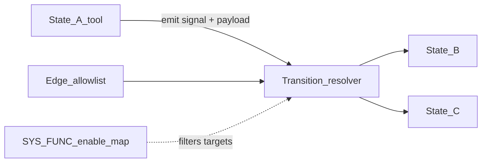
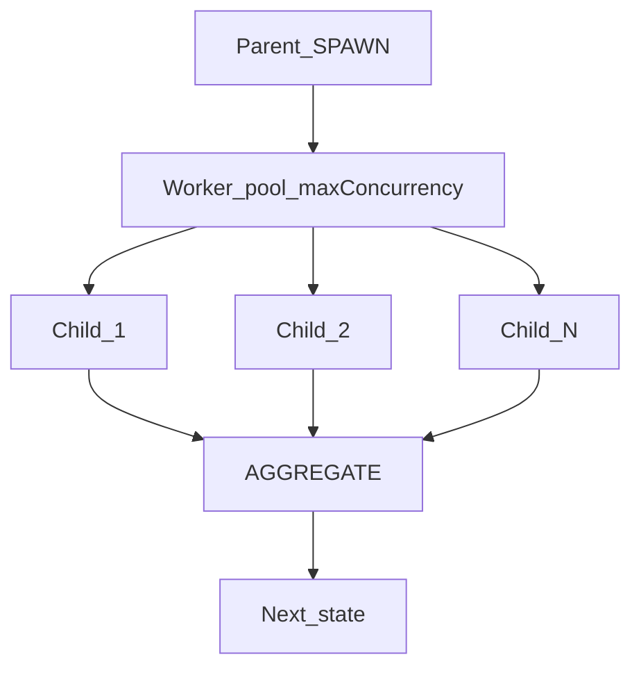

# 001 — Workflow Canvas

> Status: **Complete (v1 C1–C6 + v2 C7 Round 2)** on `cursor/canvas-c7-round2` — AI/HTTP executors still stubbed; gRPC bridge deferred; live HUMAN bridge stubbed as auto-approve  
> Relates to: [DETAILED_DESIGN_PLAN.md](../DETAILED_DESIGN_PLAN.md) §§2, 5–7, 9–10  
> Code today: [`apps/web/src/lib/fsm-types.ts`](../apps/web/src/lib/fsm-types.ts), canvas + inspector under `apps/web/src/components/`, engine [`packages/fsm-engine/`](../packages/fsm-engine/)  
> Implement with: **ship-feature** on Composer/Grok · Detail updates: **detail-feature** on high-end models

---

## 1. Problem

The FSM authoring concept is strong, but the canvas still feels vague for developers:

- It is unclear which **state roles** are meant for day-to-day harness design vs. platform internals.
- States are not consistently **independently verifiable** (inputs/outputs/assertions) with first-class error + retry paths.
- Traversal is edge-authored as a static graph; the intended model is **tool chaining** — the finishing tool of a state decides the next hop from its response.
- `SYSTEM_FUNCTION` exists as a node type but has no **enable/disable map** that rewires the live tool chain.
- BYOK is stubbed; real usage needs **multiple credentials**, runtime model discovery, and **per-state model** selection.
- Custom states, signals, and SYS_FUNCs are mentioned but not specified.
- External URL / external AI setups need first-class states, not only free-form SCRIPT code.
- `SPAWN` is under-specified (`childFsm`, `count`, `strategy` only) — missing **parallel/multithreaded** execution and per-child **tool/skill** customization.

---

## 2. Goals & non-goals

### Goals

- Publish a developer-facing **state catalog** mapped to current `FSMStateType` or marked as new.
- Make every state **independently runnable/verifiable** with schemas, retries, and error signals.
- Define **tool-chained** transition semantics (response-driven next state within an edge allowlist).
- Define **SYS_FUNC → state enablement** and how the chain adjusts when a SYS_FUNC is off.
- Support **multi-BYOK** + per-state `credentialId` / `modelId`.
- Specify extension points for **custom states, signals, SYS_FUNCs**.
- Add `HTTP`/`FETCH` and `EXTERNAL_AI` state roles.
- Upgrade SPAWN/AGGREGATE for **parallel workers** and **tool/skill packs**.

### Non-goals (this feature)

- Full gRPC native-tool bridge (engine stubs SCRIPT/AI until that lands).
- Calendar / Notifications.
- Multiplayer canvas editing.

---

## 3. Proposed model

### 3.1 State catalog (A1)

| Role | Purpose | Today (`FSMStateType`) | Notes |
|------|---------|------------------------|-------|
| `START` | Hydration / phase map | `START` | State 0 |
| `HTTP` / `FETCH` | Call external URL | **new** (or SCRIPT subtype) | Auth via credential ref |
| `SCRIPT` | Deterministic native tool | `SCRIPT` | gRPC tool |
| `AI` | Generative reasoning | `AI` | BYOK model select |
| `EXTERNAL_AI` | Hit a non-platform AI endpoint | **new** | Distinct from in-app BYOK pool usage |
| `VALIDATE` | Assert schema / predicate | **new** | Gate before next hop — ⚠ redundancy under review, see §10.1 |
| `BRANCH` | Explicit multi-way on tool payload | pattern on edges | Tool emits which allowlisted signal |
| `SPAWN` | Fan-out child FSMs | `SPAWN` | See §3.8 — ⚠ cardinality contract being formalized, see §10.3 |
| `AGGREGATE` | Merge child results | `AGGREGATE` | Typed envelope — ⚠ cardinality contract being formalized, see §10.3 |
| `SYSTEM_FUNCTION` | Checkpoint + enablement mask | `SYSTEM_FUNCTION` | See §3.4 — ⚠ being reframed as a multi-head router, see §10.2 |
| `ERR` | Shared error sink | often `END` subtype | Prefer dedicated or tagged `END` |
| `END` | Terminal success | `END` | |
| `HUMAN` | Pause for approval | **later** | Promoted into v2 scope, see §10.4 |

UI palette should group: **Flow** (START/END/ERR), **Work** (SCRIPT/HTTP/AI/EXTERNAL_AI/VALIDATE), **Control** (SYS_FUNC/SPAWN/AGGREGATE).

### 3.2 Independent, verifiable states (A2)

Every state definition gains:

```ts
{
  id: string;
  type: StateRole;
  inputSchema?: JsonSchema;   // validated on enter
  outputSchema?: JsonSchema;  // validated on exit (before transition)
  verify?: { kind: "schema" | "script"; scriptRef?: string };
  guardrails: { timeoutMs: number; retryMax: number; retryBackoffMs: number };
  onError: { signal: string; to?: string }; // default ::*.ERROR → ERR
}
```

- Success and error signals are mandatory for runnable states.
- Retries apply to the state execution only; exhausted retries emit the error signal.
- VERIFY failure is not a soft skip — it routes to error (or optional correction retry for AI).

### 3.3 Tool chaining (A3)

Traversal is **response-driven** within an **allowlist**:

1. Author draws edges: each edge is `{ on: signal, to: stateId }` (allowlist).
2. State tool finishes and returns either:
   - structured `{ signal, payload, toHint? }`, or
   - signal string `::SCRIPT.NEXT|message=...` (existing grammar).
3. Runtime resolves `signal` → matching outgoing edge; if `toHint` is present it must match an allowlisted target or the run halts with validation error.
4. No edge for the emitted signal → error / halt (configurable).



### 3.4 SYS_FUNC → state map (A4)

Extend `SystemFunctionConfig`:

```ts
{
  summaryStrategy: "template" | "llm";
  enabledStateIds: string[];      // states considered "on" after this boundary
  disabledStateIds?: string[];    // explicit offs (wins over enabled if both)
  rewire?: Array<{ from: string; on: string; to: string }>; // override edges when mask changes
}
```

Behavior when a SYS_FUNC is **off** (or a state is disabled by the active mask):

- Disabled states are skipped; the resolver rewrites transitions to the next enabled successor along the same signal family, or uses `rewire` entries.
- Tool packs exposed to AI/SCRIPT for the upcoming cluster include only enabled states' tools.
- Lint warns if rewiring creates unreachable END or drops all error edges.

### 3.5 Multi-BYOK + per-state model (A5–A6)

- Credentials form a **pool** (project-scoped + optional global).
- At run start: for each credential, discover models (`GET …/v1/models` or provider-specific adapter).
- Union of `{ credentialId, modelId, label }` is available in the inspector.
- Each `AI` / `EXTERNAL_AI` state stores:

```ts
{
  credentialId: string;
  modelId: string;
  temperature: number;
  maxTokens: number;
  systemPrompt: string;
  outputSchema?: string;
}
```

- Multiple BYOK options active at once are first-class; discovery is runtime, cached per run with TTL.

### 3.6 Custom states, signals, SYS_FUNCs (A7)

Extension registry (platform + project):

| Extension | Shape |
|-----------|--------|
| Custom state type | `{ id, label, executorRef, defaultSignals, inspectorSchema }` |
| Custom signal | namespaced `::MYAPP.*`; must be registered before use on edges |
| Custom SYS_FUNC template | reusable enable-map + checkpoint strategy |

Linter rejects unknown signals and unregistered custom types. Export bundles include project registry JSON.

### 3.7 External URL / external AI (A8)

**HTTP / FETCH**

```ts
{
  method: "GET" | "POST" | "PUT" | "PATCH" | "DELETE";
  urlTemplate: string;          // may use payload templates
  authCredentialId?: string;
  headers?: Record<string, string>;
  bodyTemplate?: string;
  successSignals: string[];     // map status/body → signal
}
```

**EXTERNAL_AI** — same shape as AI config but `baseUrl` + key come from a credential marked `kind: "openai_compatible" | "anthropic" | "custom"`, used for one-off endpoints not in the primary pool UX.

### 3.8 Subagents (A9)

Today `SpawnConfig` is `{ childFsm, count, strategy }`. Replace with:

```ts
type AggregationStrategy = "waitAll" | "quorum" | "firstSuccess";

interface ChildProfile {
  id: string;
  childFsm: string;                 // template FSM id / inline override ref
  toolPack: string[];               // tool names child may call
  skillPack: string[];              // skill ids (prompt/procedure bundles)
  credentialId?: string;
  modelId?: string;
  inputMap?: Record<string, string>; // parent payload path → child hydration key
  timeoutMs?: number;
}

interface SpawnConfigV2 {
  mode: "homogeneous" | "heterogeneous";
  count: number;                    // homogeneous replicas
  maxConcurrency: number;           // thread/worker cap
  strategy: AggregationStrategy;
  quorumK?: number;                 // when strategy === "quorum"
  cancelOnParentHalt: boolean;
  profiles: ChildProfile[];         // length 1 if homogeneous
  aggregateTo: string;              // AGGREGATE state id
}
```

#### Concurrency / multithreading

| Environment | Mechanism |
|-------------|-----------|
| Platform local runs (default) | **Worker pool** with `maxConcurrency` (Node `worker_threads` or equivalent async pool). Document process isolation as optional upgrade. |
| Exported harness | Process or container per child (stronger isolation); same `maxConcurrency` semantics. |

Rules:

- Children run **in parallel** up to `maxConcurrency`.
- Each child has an **isolated run context** (no shared mutable state).
- Results merge **only** at AGGREGATE.
- Parent halt + `cancelOnParentHalt` cancels in-flight children.



#### Per-subagent tools + skills

- **Tool pack**: allowlist of SCRIPT/HTTP tools (subset of parent registry or child-only).
- **Skill pack**: named skill refs the child's AI states may load (project skill registry or Cursor-style skill IDs shipped with the harness).
- Homogeneous: one profile × `count`. Heterogeneous: one profile per child (tools/skills/model may differ).
- AGGREGATE receives a typed envelope:

```ts
{
  childId: string;
  profileId: string;
  status: "ok" | "error" | "timeout" | "cancelled";
  payload?: unknown;
  error?: string;
}
```

Merge rules when packs differ: aggregate by `profileId`; do not assume homogeneous shapes — consumers read per-child envelopes.

---

## 4. UI implications

| Area | Change |
|------|--------|
| Palette | Grouped state catalog; add HTTP, VALIDATE, EXTERNAL_AI when implemented |
| Inspector | Per-state schemas, verify, error routing; AI: credential + model selects from discovered union |
| SYS_FUNC card | Enable/disable state multi-select + rewire table |
| SPAWN card | Tabs: **Topology \| Tools \| Skills \| Models \| Aggregation**; concurrency badge on node |
| Canvas SPAWN chip | e.g. `3 workers · max 2` + tool/skill counts |
| Credentials | Multi-active pool; discovery status per key |
| Linter | Unreachable, missing ERROR edges, unknown signals, empty tool pack on AI-only child, unresolved skill refs |

Reference UI today: [`fsm-canvas.tsx`](../apps/web/src/components/canvas/fsm-canvas.tsx), [`inspector-cards.tsx`](../apps/web/src/components/inspector/inspector-cards.tsx), [`credentials-view.tsx`](../apps/web/src/components/credentials/credentials-view.tsx).

---

## 5. File / API change map

| Phase | Touch | Change |
|-------|-------|--------|
| C1 | `apps/web/src/lib/fsm-types.ts` | Add `inputSchema`/`outputSchema`/`verify`/`onError` on node data; replace `SpawnConfig` with `SpawnConfigV2` + `ChildProfile`; extend `AIConfig` with `credentialId`; extend `SystemFunctionConfig` with enable maps (types only if UI deferred) |
| C1 | `apps/web/src/lib/canvas-to-dsl.ts` | Emit new fields; extend `lintCanvas` for spawn skill/tool emptiness, missing error edges |
| C1 | `apps/web/src/components/inspector/inspector-cards.tsx` | SPAWN tabs (Topology/Tools/Skills/Models/Aggregation); schema/verify fields on SCRIPT/AI |
| C1 | `apps/web/src/components/canvas/state-circle-node.tsx` | Concurrency / pack chips on SPAWN |
| C1 | `apps/web/src/stores/canvas-store.ts` | Defaults for new fields in `defaultNodeData` |
| C2 | Same inspector + `canvas-to-dsl` | SYS_FUNC enable/disable multi-select + rewire table; lint rewire |
| C3 | `apps/web/src/stores/credential-store.ts`, `credentials-view.tsx`, `app/settings/credentials/*` | Multi-active pool; real discovery replacing `MOCK_DISCOVERY` |
| C3 | AI inspector card | Model select from union of discovered models |
| C4 | `fsm-types.ts`, toolbar, inspector | New types `HTTP` / `VALIDATE` / `EXTERNAL_AI` (+ grouped palette) |
| C5 | `packages/fsm-engine/` | Transition resolver, async SPAWN pool, aggregate envelopes, `runFsm` |
| C5 | `apps/web/src/app/api/projects/[id]/runs` | Persist run + events; stub executors for SCRIPT/HTTP/AI |
| C6 | `packages/fsm-schema/` or `apps/web/src/lib/registry.ts` | Custom signal/state/SYS_FUNC registry + lint |

**Locked defaults for implementers (until open questions close):**

- Quorum includes error envelopes in the aggregate array (do not drop).
- Skill pack = project-local markdown skill ids under a future `skills/` or registry table (string refs for C1).
- Disabled SYS_FUNC states stay **visible + dimmed** on canvas.
- Platform SPAWN default = async worker **pool** (`maxConcurrency`); exported harness may use processes later.

---

## 6. Edge cases & failure modes

| Case | Expected behavior |
|------|-------------------|
| Tool emits signal with no matching edge | Halt with `transition_error`; optional route to ERR if global fallback configured |
| `toHint` not in allowlist | Validation error; do not jump |
| Retry exhausted | Emit configured error signal |
| Output schema fail after retries | Error signal / VERIFY failure |
| SYS_FUNC disables mid-chain target | Resolver skips to next enabled successor or applies `rewire`; lint if no path to END |
| `maxConcurrency < 1` | Clamp to 1 |
| Heterogeneous profiles length ≠ logical children | Lint error; refuse run |
| Empty tool pack on child that has SCRIPT states | Lint warning; run may still proceed for AI-only children |
| Unknown skill ref in skill pack | Lint error |
| Credential deleted but AI state still references it | Inspector shows broken ref; run fails at AI enter |
| Discovery fails for one of N credentials | Others still usable; failed key marked error in UI |
| Parent halt during SPAWN | Cancel children when `cancelOnParentHalt` |
| Quorum `k` > completed ok children by timeout | Aggregate with timeouts; strategy decides proceed vs error |

---

## 7. Open questions

1. Is `HTTP` a distinct `FSMStateType` or a SCRIPT template with a fixed executor? *(default for C4: distinct type)*
2. Skill pack format long-term: markdown skills in-repo vs. DB-backed procedures?
3. Worker threads vs. child processes for Windows local-dev reliability at C5?

---

## 8. Implementation phases & checklist

| Phase | Scope | Status |
|-------|--------|--------|
| C1 | Types/DSL + SPAWN inspector + lint (no engine) | **Done** (merged PR #2) |
| C2 | SYS_FUNC enable map UI + lint severity (`LintIssue`) | **Done** |
| C3 | Multi-credential discovery + per-state model union | **Done** |
| C4 | HTTP + VALIDATE + EXTERNAL_AI + grouped Flow/Work/Control palette | **Done** |
| C5 | `@fsm/engine`: tool-chained resolver + async spawn pool + `/api/projects/:id/runs` | **Done** (AI/HTTP executors stubbed) |
| C6 | Custom state/signal/SYS_FUNC registry + hard unknown-signal lint | **Done** |
| C7 | Round 2: VALIDATE tighten, SYS_FUNC router heads, SPAWN↔AGGREGATE 1:1, HUMAN + self-loops, edge kinds + uncapped conditions | **Done** |

### Remaining deferred (out of Feature 1 authoring scope)

- Live provider gateway for AI/EXTERNAL_AI (keys still client-stub; AES server storage §14).
- gRPC native SCRIPT bridge; `worker_threads` upgrade for SPAWN.
- Live HUMAN approval bridge (C7 stubs auto-`::HUMAN.APPROVE` in platform runs).
- **Custom catalog expansion, STATE/TRANSITION signals, add-state/add-signal procedure** → [013](013-state-signal-catalog.md).
- **Per-state retry events, success verifier, resume cursor, tool grants, per-state memory drop** → [014](014-run-contract.md).

Detail/revise this doc with **detail-feature** (high-end) only.

---

## 9. Acceptance criteria

- [x] State catalog documented in UI help / palette tooltips matches this doc. *(C4)*
- [x] DSL round-trip includes `inputSchema` / `outputSchema` / `SpawnConfigV2` fields. *(C1)*
- [x] Lint fails on unknown signal and on SPAWN skill ref missing from registry. *(C6)*
- [x] Credentials UI can activate ≥2 keys; AI inspector lists union of discovered models. *(C3)*
- [x] SPAWN inspector exposes maxConcurrency, tool pack, skill pack. *(C1)*
- [x] Unit tests cover transition resolver allowlist + SYS_FUNC skip rewiring. *(C5, `packages/fsm-engine`)*
- [x] Playwright: add SPAWN node → set concurrency → save → reload shows values. *(C1)*
- [x] SYS_FUNC enable/disable + rewire + severity lint. *(C2)*
- [x] HTTP / VALIDATE / EXTERNAL_AI authoring + grouped palette. *(C4)*
- [x] Engine run API writes events for START→…→END walks. *(C5)*
- [x] VALIDATE lint rejects executor bodies; SYS_FUNC heads emit + lint; SPAWN/AGGREGATE pairing lint; HUMAN + self-loop kinds. *(C7)*

---

## 10. Round 2 — C7 (decisions locked to §10.6 defaults)

Five modeling concerns from discussion — **shipped in C7** using the defaults from §10.6:

| # | Decision | Locked |
|---|----------|--------|
| 1 | Keep `VALIDATE` (tightened) vs. `gateOnly` flag | **Keep, tightened** |
| 2 | Max `RouterHead`s | **Unbounded; warn past 8** |
| 3 | `HUMAN` as router head target | **Yes** |
| 4 | SPAWN `X` static vs dynamic | **Static** |
| 5 | Self-loop `maxIterations` default | **3** |

### 10.1 `VALIDATE` — keep and tighten

- Executor-less by construction: lint `VALIDATE_HAS_EXECUTOR` if script/ai/http/externalAi bodies are populated.
- `verify` required: `VALIDATE_MISSING_VERIFY` when missing / incomplete script verify.
- Existing `VALIDATE_INCOMPLETE` still covers schema/predicate fields.

### 10.2 `SYSTEM_FUNCTION` as router

- `RouterHead[]` on `SystemFunctionConfig` (`heads`); canvas renders per-head handles; inspector **Heads** table.
- Lint: `SYSFUNC_FEW_HEADS` (&lt;2), `SYSFUNC_MANY_HEADS` (&gt;8), `SYSFUNC_HEAD_UNRESOLVED`.

### 10.3 SPAWN 1→X / AGGREGATE X→1

- `AggregateConfig { fromSpawnId, strategy }`; chips show `1→X` / `← X from SPAWN`.
- Lint: `SPAWN_AGGREGATE_TARGET_INVALID`, `AGGREGATE_MULTIPLE_SPAWN`, `AGGREGATE_SPAWN_MISMATCH`.

### 10.4 `HUMAN` + self-loops

- New `HUMAN` state + `HumanConfig`; `::HUMAN.*` signals.
- `TransitionEdgeKind`: `transition` | `self-loop` | `router`; self-loops default `maxIterations: 3`.
- Engine enforces self-loop cap separately from `guardrails.retryMax`.

### 10.5 Uncapped conditions + distinct edge kinds

- Inspector **Conditions** card adds/removes unlimited `transition` edges.
- Router / self-loop edges use distinct dash styles and are excluded from some reachability/error-edge checks (`router` edges skipped for UNREACHABLE/DEAD_END/MISSING_ERROR_EDGE).

Once further revisions arise, extend with a new phase rather than reopening C1–C6.
