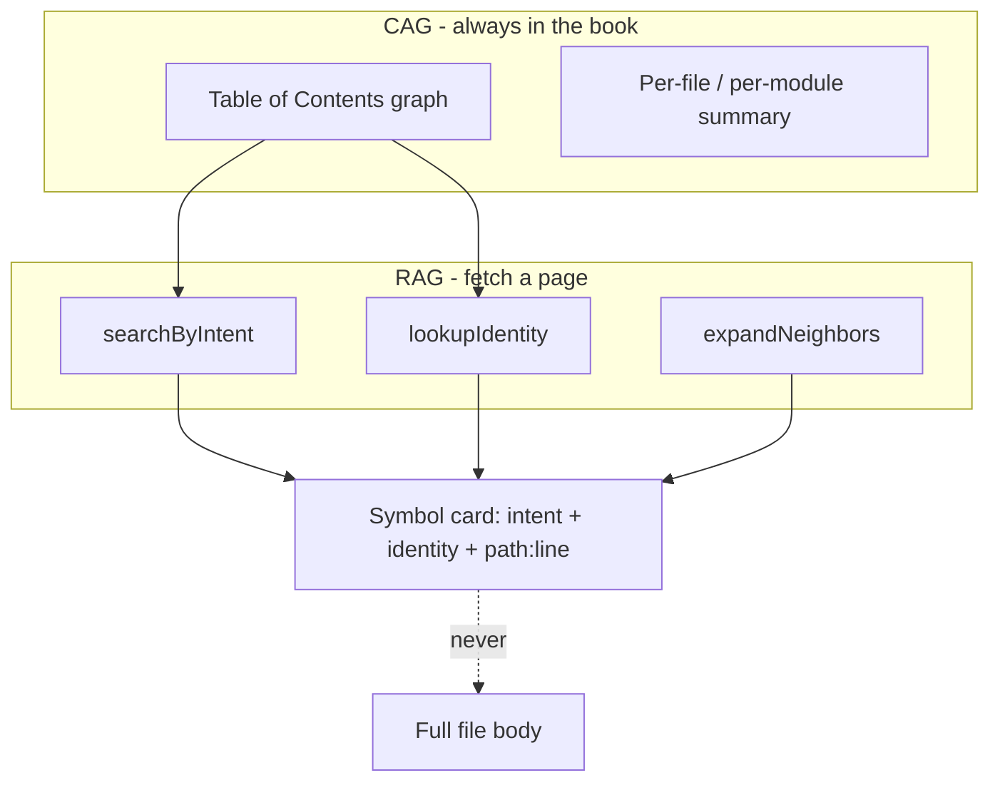

# 002 — Memory & Code Index

> Status: **Detailed** (M1 shipped on `cursor/code-index-m1-1e9b`; Book/RAG+CAG graph is B1–B3 below)  
> Relates to: [DETAILED_DESIGN_PLAN.md](../DETAILED_DESIGN_PLAN.md) §5.3  
> Code today: [`memory_nodes` / `memory_edges`](../apps/web/src/db/schema.ts), [`memory-view.tsx`](../apps/web/src/components/memory/memory-view.tsx), M1 indexer [`apps/web/src/lib/code-index/`](../apps/web/src/lib/code-index/)  
> Implement with: **ship-feature** then **test-feature** on **Grok 4.6** · Detail updates: **detail-feature**

---

## 1. Problem

Current memory is a **graph of small records in Turso** (facts, artifacts, preferences, checkpoint refs). That fits long-term harness knowledge, but not **code-intensive projects** (e.g. a LAN codebase that may exceed 50GB):

- Storing full file blobs in SQLite is not viable.
- AI states need a way to **traverse code** by meaning without dumping the repo into context.
- The Memory UI is only a sticky-note React Flow graph — fine for facts, poor for millions of symbols.

Calendar and Notifications remain out of scope.

---

## 2. Goals & non-goals

### Goals

- Split memory into **Graph memory** (existing) and **Code index memory** (new).
- Index symbols with three fields per function (and analogous for classes/types):
  1. **Intent** — what the symbol does (short natural-language summary)
  2. **Identity** — signature / params / return (stable identity string)
  3. **File location** — path + optional start/end line
- Support incremental indexing and AI retrieval that never loads 50GB into the LLM.
- Specify a **two-mode Memory studio** UI (Graph + Code Index).

### Non-goals

- Embedding the entire file contents in Turso.
- Calendar / Notifications.
- Replacing the checkpoint store (Redis/etc.) — checkpoints stay ephemeral.

---

## 3. Proposed model

### 3.1 Two memory layers

| Layer | Storage | Unit | Writers | Readers |
|-------|---------|------|---------|---------|
| **Graph memory** | Turso `memory_nodes` / `memory_edges` | fact / artifact / preference / checkpoint_ref | UI, SYS_FUNC summaries, audit | State 0 phase map, AI hydration |
| **Code index** | Symbol table (Turso or sidecar SQLite) + optional embedding/chunk store on disk | `CodeSymbol` | Indexer job | AI tools (`memory.search_code`), VALIDATE helpers |

Large blobs (raw files, embeddings) live **outside** the platform DB (workspace disk / object store). DB holds metadata + pointers only.

### 3.2 Code symbol record (B1)

```ts
interface CodeSymbol {
  id: string;
  projectId: number;
  kind: "function" | "class" | "method" | "type" | "module";
  intent: string;           // (i) natural-language purpose
  identity: string;         // (ii) e.g. "connect(host: str, port: int) -> Socket"
  filePath: string;         // (iii) repo-relative path
  startLine?: number;
  endLine?: number;
  language?: string;
  hash: string;             // content hash for staleness
  embeddingRef?: string;    // optional vector id / file offset
  chunkRef?: string;        // optional body snippet pointer (not full file)
  indexedAt: string;        // ISO
}
```

### 3.3 Indexing pipeline

1. Author opts in per project: root path(s), ignore globs (`node_modules`, `.git`, build dirs, binaries).
2. Walker enumerates source files by language allowlist.
3. Extractor (tree-sitter / language parsers) emits candidate symbols.
4. Intent writer: deterministic stub from docstring/name, optional cheap LLM batch for intent enrichment (BYOK, budget-capped).
5. Upsert by `(projectId, filePath, identity)` using `hash` for incremental skip.
6. On file change: re-index that file only; mark deleted symbols stale/removed.

Never index binary blobs or files over a size threshold (configurable; default e.g. 1MB text).

### 3.4 AI traversal

AI / SCRIPT tools request retrieval, not raw trees:

- `search_by_intent(query, k)`
- `search_by_path(prefix)`
- `lookup_identity(identityOrPartial)`
- `expand_neighbors(symbolId)` (same-file / import graph later)

Returned payloads are **symbol cards** (intent + identity + location ± small chunk). The model then requests specific files via SCRIPT/HTTP only when needed.

State 0 may include a **code-index TOC** (top packages + symbol counts), not the full index.

### 3.5 Schema delta (illustrative)

```sql
-- platform DB (metadata only)
CREATE TABLE code_symbols (
  id INTEGER PRIMARY KEY,
  project_id INTEGER NOT NULL REFERENCES projects(id) ON DELETE CASCADE,
  kind TEXT NOT NULL,
  intent TEXT NOT NULL,
  identity TEXT NOT NULL,
  file_path TEXT NOT NULL,
  start_line INTEGER,
  end_line INTEGER,
  language TEXT,
  hash TEXT NOT NULL,
  embedding_ref TEXT,
  chunk_ref TEXT,
  indexed_at INTEGER NOT NULL
);
CREATE INDEX code_symbols_project_path ON code_symbols(project_id, file_path);
CREATE INDEX code_symbols_project_identity ON code_symbols(project_id, identity);
```

Embeddings: separate store or `embedding_ref` into a local vector index under `.fsm-index/`.

---

## 4. UI proposal — Memory studio (B2)

Replace “graph-only” as the sole UX with a **two-mode** studio at `/memory` (and project-scoped `/project/[id]/memory` when wired).

### Mode switch

Top-level tabs: **Graph** | **Code Index**

### Graph mode (keep)

- Current sticky-note React Flow for facts / preferences / artifacts / checkpoint_refs ([`memory-view.tsx`](../apps/web/src/components/memory/memory-view.tsx)).
- Add/edge forms remain; improve filters by kind.

### Code Index mode (primary for large repos)

```
┌─────────────────────────────────────────────────────────────┐
│ Search…          [kind ▾] [path ▾] [stale only]  [Re-index] │
├──────────┬────────────────────────────┬─────────────────────┤
│ File     │ Symbol list                │ Detail              │
│ tree /   │ intent · identity          │ Intent              │
│ packages │ path:line                  │ Identity (params)   │
│          │                            │ Location            │
│          │                            │ Refs / chunk preview│
├──────────┴────────────────────────────┴─────────────────────┤
│ Indexed: 184k symbols · 12.4k files · last run 2m ago · 94% │
└─────────────────────────────────────────────────────────────┘
```

- **Left:** package / folder navigator (virtualized).
- **Center:** searchable symbol list (virtualized); columns intent + identity + path.
- **Right:** detail pane for the three required fields + hash/stale badge.
- **Top:** search + filters; **Start index** / **Re-index** actions.
- **Status bar:** symbol count, file count, last indexed, coverage %.

### Empty / onboarding

1. Empty Code Index → wizard: select root path(s), ignore globs, language allowlist, optional “enrich intents with BYOK”.
2. Progress stream for first index (file N of M).
3. Link from project bento “Memory” into studio with project filter applied.

### Visual direction

- Do **not** reuse sticky notes for symbols (too dense).
- Use a dense IDE-like layout (tree + list + detail) that matches coding workflows.
- Graph mode keeps the existing hand-drawn sticky language for soft knowledge.

---

## 5. File / API change map

| Phase | Touch | Change |
|-------|-------|--------|
| M1 | `apps/web/src/app/memory/actions.ts` (or `code-index/actions.ts`) | `upsertSymbols`, `searchByIntent`, `searchByPath`, `lookupIdentity`, `getIndexStats` (table already in SB0) |
| M2 | `apps/web/src/components/memory/memory-view.tsx` | Shell with Graph / Code Index tabs; Graph embeds current view |
| M2 | `apps/web/src/components/memory/code-index-view.tsx` (new) | Tree + list + detail + status bar (empty/mock data OK) |
| M2 | `apps/web/src/app/memory/page.tsx` | Pass project filter; tab routing via query `?mode=index` |
| M3 | `apps/web/src/lib/code-index/` (new) | Walker, ignore globs, TS extractor, hash, upsert batch |
| M3 | Code Index UI | Start index wizard + progress |
| M4 | Enrichment job module | Optional BYOK intent rewrite; stale-by-hash |
| M5 | Engine/tool adapters later | `memory.search_code` tool; State 0 TOC snippet |
| M6 | Virtualization | Large list perf; Playwright fixture repo |

**Locked defaults:**

- First extractor language: **TypeScript/TSX**.
- Max file size indexed as text: **1 MiB**.
- Default ignore: `node_modules`, `.git`, `.next`, `dist`, `build`, `*.min.js`, binaries.
- Intent without LLM: docstring or name-derived; enrichment opt-in.
- Symbol table in **same Turso/libSQL** for M1; embeddings deferred (`embedding_ref` nullable).

---

## 6. Edge cases & failure modes

| Case | Expected behavior |
|------|-------------------|
| Root path missing / unreadable | Wizard error; no partial corrupt index write |
| File > 1 MiB | Skip + count in `skippedLarge` stats |
| Binary / null bytes | Skip |
| Re-index same hash | No-op upsert |
| File deleted | Remove symbols for that path |
| Concurrent re-index | Single-flight lock per project |
| Empty intent after extract | Fallback = `kind + identity` |
| Search with empty query | Recent symbols capped (e.g. 50) |
| 50GB tree | Stream indexer; virtualize UI |
| Project delete | Cascade delete `code_symbols` |

---

## 7. Open questions

1. Per-project sidecar SQLite vs Turso-only for huge indexes long-term?
2. Exported harness: frozen `code-index.json` vs re-index at run site?
3. Cross-project shared index for monorepos?

---

## 8. Suggested implementation phases

| Phase | Scope | Model lane |
|-------|--------|------------|
| M1 | Search/CRUD actions (`code_symbols` already in SB0) | Composer/Grok via `ship-feature` |
| M2 | Memory studio tabs + Code Index shell | Composer/Grok |
| M3 | TS indexer MVP + wizard/progress | Composer/Grok |
| M4 | Intent enrichment + staleness | Composer/Grok |
| M5 | AI retrieval tools + State 0 TOC | **Superseded by B1–B3** |
| M6 | Virtualization + E2E polish | After B2 if lists stay |

| Phase | Scope | Model |
|-------|--------|--------|
| **B1** | CAG TOC builder + file summaries from `code_symbols` (intent/identity only). Pure lib. | Grok 4.6 |
| **B2** | Graphical Memory studio: facts graph **and** code-book graph on `/memory`. | Grok 4.6 |
| **B3** | RAG retrieve-by-intent / lookup-identity + `expandNeighbors`; State 0 TOC string (≤400 tokens). | Grok 4.6 |

Detail/revise this doc with **detail-feature** (high-end) only. B* phases use **Grok 4.6** subagents.

---

## 9. Acceptance criteria

- [ ] Graph memory behavior unchanged for existing node kinds.
- [ ] Code symbol records persist intent, identity, file location; no full 50GB corpus in Turso.
- [ ] Incremental re-index updates only changed files (hash check).
- [ ] Memory UI offers Graph and Code Index modes; Code Index shows tree + list + detail.
- [ ] Search by intent substring and by path prefix returns expected symbols (Vitest).
- [ ] Playwright: open Memory → Code Index → run index on fixture repo → see ≥1 symbol with three fields.
- [ ] AI retrieval helper returns bounded card payloads (max k, max chars).
- [ ] TOC (CAG) is a graph of dir → file → symbol keyed by **intent + identity**, never file bodies.
- [ ] RAG `searchByIntent` / `lookupIdentity` / `expandNeighbors` return symbol cards only.
- [ ] `/memory` shows the code book as React Flow (not table-only); click a node to open intent/identity/location.
- [ ] State 0 can consume `formatTocForPrompt(toc)` under 400 tokens.

---

## 10. Book memory — graph + RAG + CAG (B1–B3)

Treat project memory as a **book** whose only addressable pages are **intent** (what) and **identity** (who/signature). The UI and the runtime both navigate a **graph**, not a blob dump.

### 10.1 Metaphor



| Layer | Name | What is stored | What the model sees |
|-------|------|----------------|---------------------|
| **CAG** | Table of contents | Directory → file → symbol **graph** plus a one-line **code summary** per file (derived from that file's symbol intents, no LLM required) | The TOC string / subgraph, hard-capped (400 tokens for State 0, 2k for the studio overview) |
| **RAG** | Page retrieval | `code_symbols.intent` + `identity` + location (+ optional `chunkRef`) | A **card** (`k ≤ 8`, `maxChars ≤ 800` per card). File bodies are not the retrieval key. |
| **Graph knowledge** | Sticky facts | Existing `memory_nodes` / `memory_edges` | Top-N facts already in State 0 |

**Identity mapping:** `identity` is the stable key (`connect(host: string, port: number): Socket`). Lookups and graph node ids for symbols use `projectId + filePath + identity`.

**Intent mapping:** `intent` is the natural-language purpose. Search is substring / token overlap on intent (embeddings stay `embedding_ref` nullable — M4).

### 10.2 Graphical representation (required)

Code memory is **not** table-only. `/memory` has two graph layers on the same React Flow canvas (toggle or combined):

| Node | Source | Label | Data |
|------|--------|-------|------|
| Directory | path segments | folder name | `{ kind: "dir", path }` |
| File | unique `filePath` | file name | `{ kind: "file", path, summary }` |
| Symbol | `code_symbols` row | intent (short) | `{ kind: "symbol", intent, identity, filePath, startLine }` |
| Fact / artifact / … | `memory_nodes` | existing sticky | unchanged |

Edges:

| Relation | From → to |
|----------|-----------|
| `contains` | dir → dir, dir → file, file → symbol |
| `references` | symbol → symbol when identity of A appears in B's intent/identity text (heuristic v1; import graph later) |
| existing fact relations | unchanged |

Clicking a symbol node opens the detail pane (intent, identity, location). Double-click file node expands/collapses children.

Layout: deterministic layered layout (dir columns left → files → symbols). No random seeds.

### 10.3 TOC builder (CAG)

```ts
// apps/web/src/lib/memory/book-toc.ts
export interface TocSymbol { identity: string; intent: string; kind: string; startLine?: number }
export interface TocFile { path: string; summary: string; symbols: TocSymbol[] }
export interface TocDir { path: string; children: Array<TocDir | TocFile>; fileCount: number; symbolCount: number }
export interface MemoryBook {
  root: TocDir;
  stats: { fileCount: number; symbolCount: number };
}
export function buildMemoryBook(symbols: Array<{
  filePath: string; identity: string; intent: string; kind: string; startLine?: number | null;
}>): MemoryBook;
export function fileSummary(symbols: TocSymbol[]): string; // first 1–3 intents, ≤ 160 chars
export function formatTocForPrompt(book: MemoryBook, budgetTokens?: number): string;
export function bookToFlow(book: MemoryBook): { nodes: FlowNode[]; edges: FlowEdge[] };
```

`fileSummary`: concatenate unique intents, truncated. No extra DB column.

`formatTocForPrompt`: markdown outline `## dir / file — summary` plus at most 2 identities per file; drop deepest files first when over budget.

### 10.4 RAG API (intent + identity only)

Reuse M1 actions; add neighbor walk:

```ts
searchByIntent(projectId, query, k = 8): SymbolCard[]
lookupIdentity(projectId, identityOrPartial): SymbolCard | null
expandNeighbors(projectId, identity, hops = 1): SymbolCard[]  // same file + heuristic references
```

`SymbolCard = { intent, identity, filePath, startLine, kind }` — no source text.

### 10.5 File / API map (B*)

| Phase | Touch | Change |
|-------|-------|--------|
| B1 | `apps/web/src/lib/memory/book-toc.ts` (+ test) | `buildMemoryBook`, `fileSummary`, `formatTocForPrompt`, `bookToFlow` |
| B2 | `memory-view.tsx`, `memory/page.tsx` | Layers: **Knowledge** (facts) / **Code book** (TOC graph). Index fixture button. Detail drawer. |
| B2 | `apps/web/src/app/memory/actions.ts` | `getMemoryBook(projectId)` reads `code_symbols` and returns `MemoryBook` |
| B3 | `code-index/actions.ts` | `expandNeighbors`; keep search/lookup |
| B3 | `apps/web/src/lib/context/memory-toc.ts` | `formatTocForPrompt` wrapper for 011 phase map |

Do **not** edit `schema.ts`. Do **not** edit `run-supervisor.ts` in B1–B2.

### 10.6 Tests

**Vitest B1:** fixture symbols under `src/a.ts` + `src/b.ts` → TOC has two files; summaries non-empty; `bookToFlow` nodes include dir/file/symbol; `formatTocForPrompt` respects a tiny budget.

**Vitest B3:** `expandNeighbors` returns same-file symbols; `searchByIntent` still matches M1.

**Playwright B2:** `/memory` → Code book → after indexing `apps/web/fixtures/code-index-sample` (or seed) → graph shows at least one symbol node whose label/detail includes intent **and** identity.

### 10.7 Locked (Q41–Q43)

See [000](000-completion-roadmap.md) §6.
