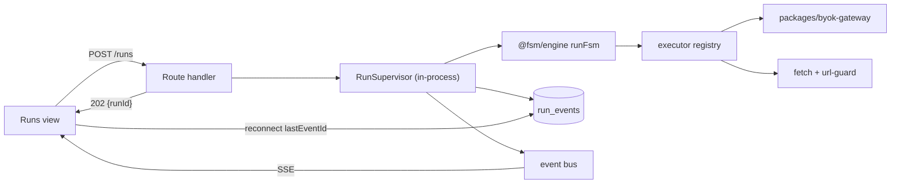

# 003 — Live Executors

> Status: **Detailed**
> Relates to: [DETAILED_DESIGN_PLAN.md](../DETAILED_DESIGN_PLAN.md) §§6, 9 · Roadmap Wave 1
> Code today: [`run-engine.ts`](../apps/web/src/lib/run-engine.ts) `stubExecute`, [`runs/route.ts`](../apps/web/src/app/api/projects/[id]/runs/route.ts) (blocking POST)
> Depends on: [005](005-credential-security.md) S2 for live keys (E1 runs under `FSM_MOCK_PROVIDER=1` without it) · [009](009-canvas-persistence.md) P3 to run published versions (E1 may snapshot per run until then) · [006](006-ci-pipeline.md) CI3 for Playwright in CI

---

## What

Replace `stubExecute` with real executors — AI inference, HTTP, schema validation, and human approval — running in a non-blocking supervisor that streams events to the browser over SSE.

## Why

`stubExecute` returns a hard-coded success signal for every state type, so today a "run" only proves that the transition graph is well formed. Nothing is called, nothing can fail, retries and timeouts never fire, and the response only arrives once the whole loop finishes. This is the single largest gap between the product's promise and its behavior: without live executors, the canvas cannot validate a real harness, and 011 (tokens), 008 (notifications), and 004 (export smoke) have nothing to measure.

## How

### Architecture



`POST /api/projects/[id]/runs` inserts the run, starts execution on the supervisor, and returns **202 `{ runId }`** immediately. `GET /api/runs/[runId]/stream` is an SSE endpoint: it replays persisted `run_events` after `Last-Event-ID`, then follows live ones. Persistence stays the source of truth, so a dropped connection loses nothing.

### Executor registry

```ts
// apps/web/src/lib/executors/types.ts
export interface ExecutorContext {
  runId: number;
  state: EngineState;
  payload: unknown;
  signal: AbortSignal;
  emit(ev: RunEventDraft): Promise<void>;  // persist + broadcast
}
export type Executor = (ctx: ExecutorContext) => Promise<Emission>;
export const executors: Record<StateType, Executor>;
```

| State | Behavior | Success | Failure |
|-------|----------|---------|---------|
| `AI` | Chat completion via gateway using the node's `credentialId` + `model` + `temperature` + `maxTokens` + `systemPrompt`; validates against `outputSchema` when present | `::AI.NEXT` | `::AI.ERROR` after `guardrails.retryMax` |
| `EXTERNAL_AI` | Same path, different default adapter/base URL | `::EXTERNAL_AI.NEXT` | `::EXTERNAL_AI.ERROR` |
| `HTTP` | `fetch` with method/url/headers/body from node config, `{{payload.x}}` templating, URL checked by [`validatePublicHttpUrl`](../apps/web/src/lib/url-guard.ts) | Status→signal map from `successSignals` | `::HTTP.ERROR` |
| `VALIDATE` | Ajv against the node's schema; no executor body (existing lint enforces this) | `::VALIDATE.NEXT` | `::VALIDATE.ERROR` |
| `SCRIPT` | Deferred to [010](010-tool-runtime-grpc.md); until then emits `::SCRIPT.ERROR` with `TOOL_RUNTIME_UNAVAILABLE` unless mock mode | — | — |
| `HUMAN` | Creates a `human_tasks` row, sets run status `awaiting_human`, suspends | Resume signal from the approval API | `::HUMAN.REJECT` / timeout |
| `SYSTEM_FUNCTION` | Emits `::SYSTEM.HYDRATE`; real checkpointing lands in [011](011-token-and-observability.md) | — | — |

### BYOK gateway package

`packages/byok-gateway` (design plan §9, created here so 012 can reuse it):

```ts
export interface ChatRequest {
  model: string; systemPrompt?: string; messages: ChatMessage[];
  temperature?: number; maxTokens?: number; jsonSchema?: object; signal?: AbortSignal;
}
export interface ChatChunk { delta: string }
export interface ChatResult { text: string; tokensIn: number; tokensOut: number; raw: unknown }
export interface ProviderAdapter {
  id: "openai" | "anthropic" | "openai-compatible" | "mock";
  chat(req: ChatRequest, key: string, baseUrl?: string): AsyncIterable<ChatChunk> & Promise<ChatResult>;
  listModels(key: string, baseUrl?: string): Promise<DiscoveredModel[]>;
}
```

Existing [`model-discovery.ts`](../apps/web/src/lib/model-discovery.ts) moves in as the `listModels` half. Keys come from `getDecryptedKey()` ([005](005-credential-security.md)) and are never logged or returned.

**Mock adapter**: when `FSM_MOCK_PROVIDER=1`, the registry resolves every provider to a deterministic adapter that echoes a templated response and reports fixed token counts. This is what makes CI E2E ([006](006-ci-pipeline.md)) possible without keys.

### Event model

`run_events.kind` values, all with `stateId` and monotonic `id` (the SSE event id):

`state.start` · `state.token` (streamed delta) · `state.output` · `state.retry` · `state.error` · `state.transition` · `human.awaiting` · `human.resolved` · `run.complete` · `run.failed`

`tokensIn` / `tokensOut` / `latencyMs` are populated on `state.output` — the columns exist and are currently always null.

### Human-in-the-loop (Q10 → in v1)

```ts
human_tasks: { id, runId, stateId, prompt, assignee?, status: "pending"|"approved"|"rejected"|"expired",
               responseJson?, createdAt, resolvedAt?, expiresAt? }
```

`POST /api/runs/[runId]/human/[taskId]` resolves the task and wakes the supervisor. On process restart, runs in `awaiting_human` are resumable because the task and events are persisted; in-flight `running` runs are marked `interrupted` at boot.

## UI implications

| Surface | Change |
|---------|--------|
| [`runs-view.tsx`](../apps/web/src/components/runs/runs-view.tsx) | Subscribe to SSE; live event log with per-state status, token counts, and latency; Cancel button |
| New `human-task-card.tsx` | Approve / reject / edit payload inline when a run is `awaiting_human` |
| [`fsm-canvas.tsx`](../apps/web/src/components/canvas/fsm-canvas.tsx) | Live node highlight for the currently executing state during a run |

## File / API change map

| Phase | Touch | Change |
|-------|-------|--------|
| E1 | `packages/byok-gateway/` (new) | Adapter interface, OpenAI + mock adapters, `listModels` migrated from web |
| E1 | `src/lib/run-supervisor.ts` (new) | Registry of active runs, `start`, `cancel`, `resume`, event bus, boot reconciliation |
| E1 | `src/app/api/projects/[id]/runs/route.ts` | Return 202 `{ runId }`; stop awaiting completion |
| E1 | `src/app/api/runs/[runId]/stream/route.ts` (new) | SSE with `Last-Event-ID` replay |
| E1 | `src/lib/executors/ai.ts` (new), `src/lib/run-engine.ts` | Real AI executor; delete `stubExecute` |
| E2 | `src/lib/executors/http.ts`, `validate.ts` (new) | HTTP with templating/timeout/retry; Ajv validation |
| E2 | `src/components/runs/runs-view.tsx` | SSE subscription, live log, cancel |
| E3 | `src/app/api/runs/[runId]/human/[taskId]/route.ts` (new), `human-task-card.tsx` (new) | Approval bridge (`human_tasks` already in SB0) |
| E4 | `packages/byok-gateway/adapters/anthropic.ts` | Anthropic + OpenAI-compatible; per-state credential binding end to end |

## Edge cases & failure modes

| Case | Expected behavior |
|------|-------------------|
| Node bound to a revoked/missing credential | `state.error` with `CREDENTIAL_UNAVAILABLE`; run fails fast, no provider call |
| Provider 429 / 5xx | Retry with backoff per `guardrails.retryMax`; emit `state.retry` each attempt; then `::AI.ERROR` |
| Provider stream stalls | `AbortController` at `guardrails.timeoutMs`; counted as a retryable attempt |
| AI output fails `outputSchema` | One correction retry with the validation error appended, then `::AI.ERROR` (Q9) |
| HTTP URL resolves to a private address | Blocked by `url-guard`; `state.error` `SSRF_BLOCKED` |
| Client disconnects | Run continues; reconnect replays from `Last-Event-ID` |
| Two SSE subscribers | Both receive events; the bus is broadcast, not consume-once |
| Cancel mid-run | `AbortSignal` propagates to fetches and spawn children; status `cancelled` |
| Process restart | `running` → `interrupted` at boot; `awaiting_human` stays resumable |
| Infinite loop | Existing engine `maxSteps` (100) and self-loop `maxIterations` still apply |
| No `PLATFORM_SECRET` | Server refuses to boot ([005](005-credential-security.md)) — runs never start keyless |

## Open questions

1. Concurrency cap per project — global semaphore, or per-project queue with a configurable width?
2. Should `state.token` deltas be persisted (replayable, chatty) or broadcast-only with just the final `state.output` stored? Proposal: broadcast-only, persist the assembled output.

## Implementation phases

| Phase | Scope | Size |
|-------|-------|------|
| E1 | Gateway package + supervisor + SSE + AI executor | 1 PR |
| E2 | HTTP + VALIDATE executors, live runs UI | 1 PR |
| E3 | Human-in-the-loop pause/resume | 1 PR |
| E4 | Anthropic / OpenAI-compatible + per-state binding | 1 PR |

## Test plan

**Vitest** — `packages/byok-gateway/src/*.test.ts`, `apps/web/src/lib/executors/*.test.ts`

- OpenAI adapter maps a streamed SSE body into `ChatChunk`s and a final `ChatResult` with token counts.
- Adapter surfaces 401 as `AUTH_FAILED` and 429 as retryable.
- Mock adapter is deterministic: identical requests produce identical text and token counts.
- AI executor retries exactly `retryMax` times on a failing injected provider, emitting one `state.retry` per attempt.
- AI executor emits `::AI.ERROR` (not a throw) when output fails `outputSchema` twice.
- HTTP executor templates `{{payload.id}}` into URL, headers, and body.
- HTTP executor maps 200→`::HTTP.NEXT`, 404→configured signal, 500→`::HTTP.ERROR`.
- HTTP executor refuses `http://169.254.169.254/...` with `SSRF_BLOCKED` before any fetch.
- HTTP executor aborts at `timeoutMs` and counts it as an attempt.
- VALIDATE executor passes a conforming payload and fails a non-conforming one with the Ajv path in the message.
- Supervisor writes `state.start` before and `state.output` after each state, in monotonic id order.
- Supervisor `cancel()` aborts an in-flight executor and ends the run as `cancelled`.
- SSE replay from `lastEventId = N` returns only events with `id > N`.
- Boot reconciliation flips orphaned `running` rows to `interrupted`.
- Human task resolution resumes the run with the approval signal; expiry emits `::HUMAN.REJECT`.
- A key is never present in any emitted event payload (property-based over the event stream).

**Playwright** — `e2e/live-run.spec.ts`, `e2e/human-task.spec.ts` (both `FSM_MOCK_PROVIDER=1`)

- Build START → AI → END, publish, Run → events stream in incrementally and the run ends `succeeded`.
- The executing node is highlighted on the canvas while its state runs.
- Reload mid-run → the log repopulates from replay and keeps following.
- Cancel a run → status becomes `cancelled` and no further events arrive.
- HTTP state pointed at a stubbed route (`page.route`) → the mapped success signal appears in the log.
- HUMAN state pauses the run, the approval card appears, approving resumes it to `succeeded`.
- A run with a deleted credential fails with a visible `CREDENTIAL_UNAVAILABLE` error.

## Acceptance criteria

- [ ] `stubExecute` is deleted; every state type routes through the executor registry.
- [ ] `POST /runs` returns within 200 ms with a `runId` while execution continues.
- [ ] Events stream over SSE and survive a page reload via `Last-Event-ID` replay.
- [ ] `tokensIn`, `tokensOut`, and `latencyMs` are populated for AI states.
- [ ] Retries, timeouts, and error signals are observable in the run log.
- [ ] HUMAN states pause and resume across a server restart.
- [ ] `FSM_MOCK_PROVIDER=1` runs the full suite with no API key.
- [ ] Vitest and Playwright suites above pass in CI.
