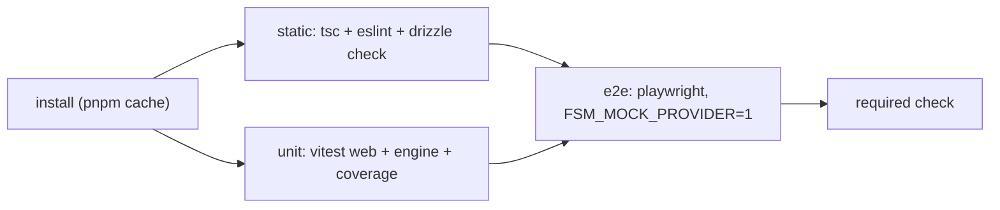

# 006 — CI Pipeline

> Status: **Detailed**
> Relates to: [DETAILED_DESIGN_PLAN.md](../DETAILED_DESIGN_PLAN.md) §§12–13 · Roadmap Wave 0
> Code today: [`.github/workflows/ci.yml`](../.github/workflows/ci.yml) — typecheck + Vitest; lint `continue-on-error`; Playwright commented out
> Gates: every other doc · Implement with: **ship-feature** (Composer/Grok)

---

## What

Turn the current advisory workflow into a real gate: lint blocking, Playwright running against a mock provider, migrations verified, and coverage reported.

## Why

CI exists but enforces almost nothing. Seventeen lint errors are ignored by `continue-on-error`, and the six Playwright specs — the only tests that prove the product actually works in a browser — never run. Every later wave adds executors, crypto, and codegen whose regressions are invisible to a typecheck. The roadmap's rule that "a phase is not Shipped until CI is green" is meaningless until CI can fail.

## How

### Current lint debt (CI2 scope)

Seventeen errors, all React Compiler rules, in nine files:

| Rule | Count | Files | Fix pattern |
|------|-------|-------|-------------|
| `react-hooks/set-state-in-effect` | 8 | `mode-toggle`, `project-list`, `theme-provider`, `animated-grid-pattern`, `magic-card`, `meteors`, `terminal` (×2) | Derive during render, or move the write into an event/`useSyncExternalStore` |
| `react-hooks/static-components` | 5 | `export-wizard` (86, 120, 142, 164, 189) | Hoist the `Section` component out of the render body |
| `react-hooks/purity` | 4 | `copilot-panel` (79–80), `dot-pattern` (105–106) | Seed randomness in an effect/ref, or accept a `seed` prop |
| `react-hooks/rules-of-hooks` | 1 | `edge-inspector.tsx:60` | Hoist the hook above the early return |
| `@typescript-eslint/no-unused-vars` | 1 (warn) | `project/[id]/page.tsx:1` | Remove unused `desc` |

These are mechanical and should land as **one dedicated cleanup PR** before the rule is made blocking, so feature PRs never carry unrelated churn.

### Target workflow shape

Three jobs replacing today's single `check`:

| Job | Steps | Blocking |
|-----|-------|----------|
| `static` | `tsc --noEmit`, `pnpm --filter web lint`, `drizzle-kit generate --check` (schema and committed migrations agree) | Yes (after CI2) |
| `unit` | `pnpm --filter web test -- --coverage`, `pnpm --filter @fsm/engine test`, upload coverage summary | Yes |
| `e2e` | `playwright install --with-deps chromium` (cached by version), build web, run specs with `FSM_MOCK_PROVIDER=1` and `PLATFORM_SECRET` from a workflow-level dummy, upload traces on failure | Yes on PR |

`FSM_MOCK_PROVIDER=1` (defined in [003](003-live-executors.md)) is what makes E2E affordable — no API key, no spend, deterministic output.

### Coverage policy

Report only at first (`--coverage` with a summary comment). Introduce thresholds once Wave 1 lands, scoped to logic directories rather than the whole app: `src/lib/**` and `packages/**` at 80% lines.

## File / API change map

| Phase | Touch | Change |
|-------|-------|--------|
| CI2a | 9 component files listed above | Mechanical lint fixes, no behavior change |
| CI2b | `.github/workflows/ci.yml` | Split into `static` / `unit` jobs; remove `continue-on-error` from lint; add `drizzle-kit generate --check` |
| CI3 | `.github/workflows/ci.yml` | Add `e2e` job with cached browsers, env, trace artifacts |
| CI3 | `apps/web/playwright.config.ts` | `webServer` uses the production build in CI; `retries: 2` on CI; `trace: "on-first-retry"` |
| CI3 | `package.json` (root) | `test:ci` = unit + e2e; `test:e2e:ci` with reporter config |
| CI4 | `.github/workflows/ci.yml` | Coverage thresholds; concurrency + path filters so doc-only PRs skip `e2e` |

## Edge cases & failure modes

| Case | Expected behavior |
|------|-------------------|
| Docs-only PR | `paths-ignore` skips `e2e`; `static` and `unit` still run |
| Playwright flake | `retries: 2` on CI plus trace upload; a spec that flakes twice is quarantined via `test.fixme` with a linked issue, never by disabling the job |
| Browser download timeout | Cache keyed on the Playwright version; fall back to a single retry |
| Missing `PLATFORM_SECRET` in CI | Workflow sets a dummy value; the boot check from 005 must pass |
| Schema drift | `drizzle-kit generate --check` fails the `static` job with the diff |
| Fork PRs | No secrets needed — mock provider only |

## Open questions

1. Full E2E on every PR, or smoke on PR and the full grid nightly once specs exceed ~30?
2. Add a `build` job (`next build`) as a separate gate, or fold it into `e2e`'s `webServer`?

## Implementation phases

| Phase | Scope | Size |
|-------|-------|------|
| CI1 | Typecheck + unit workflow | **Shipped** (PR #5) |
| CI2a | Lint cleanup PR (17 errors) | 1 PR |
| CI2b | Jobs split; lint + migration check blocking | 1 PR |
| CI3 | Playwright job with cached browsers and traces | 1 PR |
| CI4 | Coverage thresholds + path filters | 1 PR |

## Test plan

CI is itself the test harness, so the coverage here is the pipeline's own behavior.

**Vitest** — `src/lib/env-guard.test.ts`

- `FSM_MOCK_PROVIDER` parsing: `"1"`/`"true"` enable, absent/`"0"` disable.
- Boot guard reports every missing required env var at once rather than failing on the first.

**Workflow verification (manual + PR-observable)**

- A PR that introduces a lint error fails `static` (verified once with a throwaway commit).
- A PR that edits `schema.ts` without regenerating migrations fails `drizzle-kit generate --check`.
- A PR that breaks an E2E path fails `e2e` and uploads a trace artifact.
- A docs-only PR runs `static` + `unit` and skips `e2e`.
- Cold-cache and warm-cache runs both finish under 15 minutes.

## Acceptance criteria

- [ ] `pnpm --filter web lint` reports zero errors and is a required, blocking step.
- [ ] All six existing Playwright specs run in CI and pass against `FSM_MOCK_PROVIDER=1`.
- [ ] Schema/migration drift fails the build.
- [ ] Failed E2E runs upload traces.
- [ ] Doc-only PRs skip the browser job.
- [ ] Total PR feedback time stays under 15 minutes on a warm cache.
