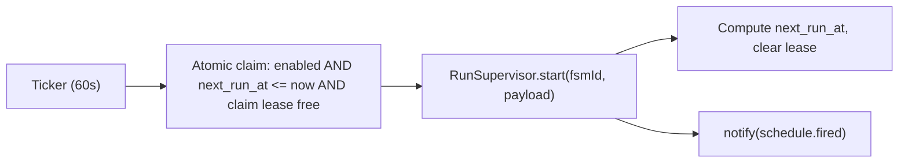

# 007 — Calendar & Scheduled Runs

> Status: **Detailed**
> Relates to: [DETAILED_DESIGN_PLAN.md](../DETAILED_DESIGN_PLAN.md) §19 (E10) · Roadmap Wave 4
> Code today: bento tile in [`page.tsx`](../apps/web/src/app/page.tsx) (lines 131–138) with `cta="Soon"` — no schema, no route, no scheduler
> Depends on: [009](009-canvas-persistence.md), [008](008-notifications.md) · Implement with: **ship-feature** (Composer/Grok)

---

## What

Scheduled harness runs — cron and one-shot — with a calendar surface that shows what fired, what is due, and lets an author trigger or pause a schedule.

## Why

A harness that only runs when someone clicks Run is a demo, not automation. The tile has promised scheduling since the first scaffold, and the pieces it needs now exist: [009](009-canvas-persistence.md) gives a published version to run without a browser present, [003](003-live-executors.md) runs it without blocking a request, and [008](008-notifications.md) reports the outcome. Scheduling is the step that turns authored workflows into unattended automation.

## How

### Schema

```ts
schedules: {
  id: integer pk,
  projectId: integer → projects (cascade),
  fsmId: integer? → fsm_definitions,   // null = always the latest published version
  name: text,
  kind: "cron" | "once",
  cronExpr: text?,                     // 5-field cron, required when kind = "cron"
  runAt: integer?,                     // epoch, required when kind = "once"
  timezone: text,                      // IANA, default "UTC" (Q: project-local, see below)
  payloadJson: text?,                  // initial run payload
  enabled: integer default 1,
  lastRunAt: integer?, lastRunId: integer?,
  nextRunAt: integer,                  // materialized for cheap due queries
  claimedAt: integer?,                 // single-flight lease
  createdAt: integer, updatedAt: integer,
}
```

Index on `(enabled, next_run_at)` so the ticker's due query is a single indexed scan.

### Scheduler



A 60-second in-process ticker inside the Node server. Claiming is a conditional `UPDATE ... WHERE claimed_at IS NULL OR claimed_at < now - 5min RETURNING`, so a duplicate ticker (during a rolling deploy, or a second instance) cannot double-fire. Missed windows while the process was down are **not** backfilled — the next occurrence is computed from now, and a `schedule.missed` notification records the skip. Hosts that prefer an external trigger can disable the ticker with `SCHEDULER_ENABLED=0` and hit `POST /api/scheduler/tick` from a platform cron instead.

Cron parsing and next-occurrence math use `cron-parser` with the schedule's IANA timezone; DST transitions resolve forward (a 2:30am daily job during a spring-forward fires at 3:00am, never twice).

### Timezone (Q)

Stored per schedule as an IANA name, defaulting to UTC, and displayed in the viewer's local zone with the source zone labelled. This avoids the ambiguity of "project-local vs user-local" by making the authored zone explicit on every row.

## UI implications

| Surface | Change |
|---------|--------|
| New `/project/[id]/calendar` | Month grid of fired and upcoming runs, plus an "Upcoming" list; click a day to see its runs |
| New `schedule-dialog.tsx` | Create/edit: name, cron builder with a plain-English preview and next-five-fires list, timezone picker, payload editor, target version |
| [`page.tsx`](../apps/web/src/app/page.tsx) | Calendar tile drops `cta="Soon"`, links to the calendar, shows the next upcoming fire |
| [`runs-view.tsx`](../apps/web/src/components/runs/runs-view.tsx) | Runs show a "triggered by schedule" badge linking back |

## File / API change map

| Phase | Touch | Change |
|-------|-------|--------|
| Cal1 | `src/lib/schedule/cron.ts` (new) | `nextOccurrence(expr, tz, from)`, `describeCron(expr)`, validation (`schedules` already in SB0) |
| Cal1 | `src/app/project/[id]/calendar/actions.ts` (new) | `createSchedule`, `updateSchedule`, `deleteSchedule`, `toggleSchedule`, `listSchedules`, `runNow` |
| Cal2 | `src/app/project/[id]/calendar/page.tsx`, `src/components/calendar/*` (new) | Month grid, upcoming list, schedule dialog |
| Cal2 | `src/app/page.tsx` | Live Calendar tile |
| Cal3 | `src/lib/schedule/ticker.ts` (new) | 60 s loop, atomic claim, trigger, advance, lease release |
| Cal3 | `src/app/api/scheduler/tick/route.ts` (new) | External-trigger endpoint for `SCHEDULER_ENABLED=0` hosts |
| Cal3 | `src/lib/notifications/emit.ts` call sites | `schedule.fired`, `schedule.missed`, `schedule.failed` |

## Edge cases & failure modes

| Case | Expected behavior |
|------|-------------------|
| Invalid cron expression | Rejected at save with the parse error and no `nextRunAt` write |
| Two app instances | Atomic claim guarantees a single fire; the loser skips silently |
| Process down over a window | No backfill; next occurrence from now, plus a `schedule.missed` notification |
| DST spring-forward | Non-existent local time resolves forward; never fires twice |
| DST fall-back | Duplicate local hour fires once (first occurrence) |
| Project has no published version | Schedule saves but is flagged `blocked`; the ticker skips and notifies |
| Pinned `fsmId` version deleted | Falls back to `blocked`, never silently runs a different version |
| Previous run still executing | Skip this occurrence (`overlap: skip` is the only v1 policy) and note it |
| One-shot already fired | Auto-disables; kept for history |
| Schedule deleted mid-run | The in-flight run continues; the badge shows the schedule as removed |
| Clock skew / large `nextRunAt` drift | Recomputed on every claim from the expression, never incremented blindly |

## Open questions

1. Overlap policies beyond `skip` — do authors need `queue` or `cancel-previous`?
2. Should schedules travel inside exported harnesses ([004](004-harness-export.md)) as a compose cron sidecar, or stay platform-only?

## Implementation phases

| Phase | Scope | Size |
|-------|-------|------|
| Cal1 | Cron math + CRUD actions (table already in SB0) | 1 PR |
| Cal2 | Calendar UI, schedule dialog, live tile | 1 PR |
| Cal3 | Ticker, claim/lease, notifications, external tick endpoint | 1 PR |

## Test plan

**Vitest** — `src/lib/schedule/cron.test.ts`, `src/lib/schedule/ticker.test.ts`

- `nextOccurrence("0 9 * * 1-5", "UTC")` returns the next weekday 09:00 and skips weekends.
- Timezone correctness: the same expression in `America/New_York` and `Asia/Kolkata` yields different UTC instants.
- DST spring-forward: a 02:30 daily job resolves to 03:00 on the transition day and fires once.
- DST fall-back: the repeated local hour produces exactly one occurrence.
- Invalid expressions raise a validation error carrying the offending field.
- `describeCron` renders plain English for five common expressions.
- One-shot in the past does not schedule; one-shot in the future schedules exactly once and then disables.
- Claim is single-flight: two concurrent claim calls against the same due row yield one winner.
- A stale lease older than five minutes is reclaimable.
- After firing, `nextRunAt` is recomputed from the expression, not incremented by a fixed delta.
- A schedule whose project has no published version is skipped and marked `blocked`.
- An already-running schedule skips the occurrence under the `skip` policy.

**Playwright** — `e2e/calendar.spec.ts`

- Create a cron schedule → the dialog previews the next five fires and the row appears on the calendar.
- The home Calendar tile shows the next upcoming fire instead of `Soon`.
- "Run now" triggers a run immediately, and the run detail shows the schedule badge.
- Disable a schedule → it greys out and disappears from Upcoming.
- Invalid cron input surfaces an inline error and blocks save.

## Acceptance criteria

- [ ] Cron and one-shot schedules persist with correct timezone-aware `nextRunAt`.
- [ ] The ticker fires due schedules exactly once, even with two instances running.
- [ ] Fired schedules create real runs with `triggeredBy = "schedule"`.
- [ ] Outcomes surface through [008](008-notifications.md).
- [ ] The Calendar tile no longer says `Soon`.
- [ ] Vitest and Playwright suites above pass in CI.
