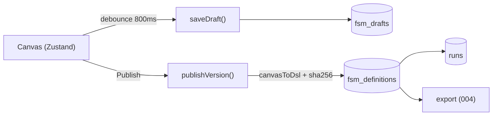

# 009 — Canvas Persistence, Versions & Run History

> Status: **Detailed**
> Relates to: [DETAILED_DESIGN_PLAN.md](../DETAILED_DESIGN_PLAN.md) §§5.1, 10.2 · Roadmap Wave 0
> Code today: [`canvas-store.ts`](../apps/web/src/stores/canvas-store.ts) (localStorage), [`run-engine.ts`](../apps/web/src/lib/run-engine.ts), [`runs-view.tsx`](../apps/web/src/components/runs/runs-view.tsx) (`MOCK_RUNS`)
> Blocks: 003, 004, 007 · Implement with: **ship-feature** (Composer/Grok)

---

## What

Make the server the source of truth for authored FSMs: debounced draft autosave, explicit immutable publish with a content hash, and a run history read from the database instead of `MOCK_RUNS`.

## Why

The entire authored workflow currently lives in one browser's `localStorage` under `fsm-canvas-store`. Clearing site data destroys a project; a second device sees nothing; `fsm_definitions` is only written as a side effect of pressing Run, always with `version: 1`. Every downstream feature — running a schedule, exporting a bundle, comparing versions — needs a server-side FSM of record, so this is the first thing that must land.

## How

Two tiers: a mutable **draft** per project (what the canvas edits) and an append-only list of **published versions** (what runs and exports reference).



### Schema delta

```ts
// apps/web/src/db/schema.ts
export const fsmDrafts = sqliteTable("fsm_drafts", {
  id: integer("id").primaryKey({ autoIncrement: true }),
  projectId: integer("project_id").notNull().unique()
    .references(() => projects.id, { onDelete: "cascade" }),
  canvasJson: text("canvas_json").notNull(),   // React Flow CanvasData
  revision: integer("revision").notNull().default(1), // optimistic-concurrency token
  updatedAt: integer("updated_at", { mode: "timestamp" }).notNull(),
});

// fsm_definitions gains:
contentHash: text("content_hash").notNull(),   // sha256 of canonical DSL JSON
label: text("label"),                          // optional human tag
// + unique index (project_id, version)
```

`runs.fsmId` already references `fsm_definitions`, so run history becomes a join once versions are real.

### Server API (Next server actions + one route handler — no new RPC layer, Q1)

| Function | File | Contract |
|----------|------|----------|
| `saveDraft(projectId, canvas, revision)` | `apps/web/src/app/project/[id]/actions.ts` | Upsert; returns `{ revision }`; rejects with `STALE_REVISION` if the caller's revision is behind |
| `loadDraft(projectId)` | same | `{ canvas, revision } \| null` |
| `publishVersion(projectId, label?)` | same | `canvasToDsl(draft)` → sha256 → insert next `version`; returns existing row unchanged when the hash matches the latest version |
| `listVersions(projectId)` | same | `{ id, version, contentHash, label, createdAt }[]` |
| `listRuns(projectId, limit)` | `apps/web/src/app/project/[id]/runs/actions.ts` | Joins `runs` → `fsm_definitions`; replaces `MOCK_RUNS` |
| `getRunEvents(runId, afterId?)` | same | Ordered events; `afterId` supports the 003 SSE replay |

`canonicalJson()` sorts object keys and drops volatile fields (node positions are **included** — layout is part of the artifact; timestamps are not) so the hash is stable.

### Client wiring

`canvas-store` keeps Zustand for interaction speed but stops being the durable copy:

- Add `syncStatus: "idle" | "saving" | "saved" | "error" | "stale"` and a debounced `scheduleSave` (800 ms trailing, flush on `visibilitychange` and route change).
- Bump the `persist` config to `version: 2` with a `migrate` that keeps localStorage strictly as an offline cache; on load, server draft wins when `updatedAt` is newer.
- One-time import: if a project has no server draft but localStorage does, upload it and toast "Imported local canvas".

### UI implications

| Surface | Change |
|---------|--------|
| [`canvas-toolbar.tsx`](../apps/web/src/components/canvas/canvas-toolbar.tsx) | Sync badge (`Saved 2s ago` / `Saving…` / `Offline`), **Publish** button with version count |
| New `version-history-dialog.tsx` | List versions, show hash + label, "Restore into draft" (copies version back into the draft, never mutates history) |
| [`runs-view.tsx`](../apps/web/src/components/runs/runs-view.tsx) | Drop `MOCK_RUNS`; render `listRuns()` with status, duration, version, and event drill-down |

## File / API change map

| Phase | Touch | Change |
|-------|-------|--------|
| SB0 | `src/db/schema.ts`, `src/db/migrations/*` | Owned by the [roadmap schema bootstrap](000-completion-roadmap.md#83-kickoff-schema-bootstrap-sb0) — do not repeat here |
| P1 | `src/lib/canonical-json.ts` (new) | `canonicalJson()` + `contentHash()` |
| P1 | `src/app/project/[id]/actions.ts` (new) | `saveDraft`, `loadDraft`, `publishVersion`, `listVersions` |
| P2 | `src/stores/canvas-store.ts` | `syncStatus`, `scheduleSave`, persist v2 migration, server-wins hydration |
| P2 | `src/components/canvas/canvas-toolbar.tsx` | Sync badge + Publish |
| P3 | `src/components/canvas/version-history-dialog.tsx` (new) | Version list + restore |
| P3 | `src/lib/run-engine.ts` | Run against a **published** `fsmId` instead of inserting a fresh definition per run |
| P4 | `src/app/project/[id]/runs/actions.ts` (new), `src/components/runs/runs-view.tsx` | Real run history + event drill-down |

## Edge cases & failure modes

| Case | Expected behavior |
|------|-------------------|
| Two tabs editing | Second save gets `STALE_REVISION`; UI shows "Canvas changed elsewhere — Reload / Overwrite" |
| Server unreachable | Badge shows `Offline`; edits stay in localStorage; retry with backoff; never silently drop |
| Publish with no changes | Returns the existing latest version (hash match), no duplicate row |
| Publish an invalid canvas | Blocked when lint has `error` severity; warnings allowed with confirm |
| Draft > 2 MiB | Reject with `DRAFT_TOO_LARGE`; suggest splitting the FSM |
| Project deleted mid-edit | Save returns `PROJECT_MISSING`; canvas goes read-only |
| Run references a deleted version | Cascade already removes runs; history hides orphans |
| localStorage newer than server | Prompt once; user picks; never auto-overwrite server history |

## Open questions

1. Version retention — keep every publish forever, or prune unreferenced versions after N?
2. Should `restore` create a new version immediately, or only load into the draft (current proposal)?

## Implementation phases

| Phase | Scope | Size |
|-------|-------|------|
| P1 | Canonical hash + draft/publish actions (tables already in SB0) | 1 PR |
| P2 | Canvas store autosave + toolbar sync badge | 1 PR |
| P3 | Version history dialog + runs use published versions | 1 PR |
| P4 | Real run history + event drill-down | 1 PR |

## Test plan

**Vitest** — `src/lib/canonical-json.test.ts`, `src/lib/draft-sync.test.ts`

- `canonicalJson` is key-order independent: two canvases differing only in key order hash equal.
- `contentHash` changes when a node's config changes; unchanged when only `updatedAt` differs.
- `publishVersion` returns the same row for an unchanged canvas (no version bump).
- `publishVersion` increments `version` monotonically across three distinct canvases.
- `saveDraft` with a stale revision returns `STALE_REVISION` and does not write.
- Draft over 2 MiB rejects with `DRAFT_TOO_LARGE`.
- Store migration v1→v2 preserves nodes/edges and marks the local copy as cache.

**Playwright** — `e2e/persistence.spec.ts`

- Edit a node label, wait for `Saved`, reopen in a fresh browser context → the label persists (proves the server, not localStorage, holds it).
- Publish twice without edits → version list shows exactly one version.
- Publish after an edit → version list shows two, with different hashes.
- Run a published version → run history lists it with status and version (no mock rows).
- Simulate offline (`context.setOffline(true)`) → badge shows `Offline`; back online → badge returns to `Saved`.

## Acceptance criteria

- [ ] Canvas edits survive clearing `localStorage` and a different browser profile.
- [ ] `fsm_definitions` rows carry a stable `content_hash` and monotonic `version` per project.
- [ ] Publishing an unchanged canvas creates no new version.
- [ ] Concurrent edits surface a conflict instead of silently overwriting.
- [ ] `runs-view` contains no mock data and lists rows from `runs`.
- [ ] Vitest and Playwright suites above pass in CI.
