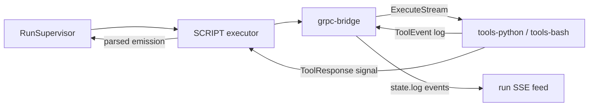

# 010 — Tool Runtime (gRPC)

> Status: **Detailed**
> Relates to: [DETAILED_DESIGN_PLAN.md](../DETAILED_DESIGN_PLAN.md) §8 (proto contract, D5/D6) · Roadmap Wave 2
> Code today: none — `packages/proto` and `packages/grpc-bridge` do not exist; `SCRIPT` states are simulated
> Depends on: [003](003-live-executors.md) · Blocks: [004](004-harness-export.md) · Implement with: **ship-feature** (Composer/Grok)

---

## What

A real tool runtime: `SCRIPT` states invoke user-authored Python and Bash tools in a sandboxed container over gRPC, streaming logs back into the run event feed.

## Why

"Deterministic work runs in native tools; the LLM only reasons" is half the product thesis, and it is the half with no code behind it. Authors can write a Python script in the inspector, save it as a template, lint it, and export it — but at run time the state just emits `::SCRIPT.NEXT`. Until tools actually execute, every harness is an LLM-only chain, and an exported bundle ([004](004-harness-export.md)) would ship containers that do nothing.

C++ is deliberately deferred: it is the heaviest build risk in the project (design plan risk register), and the Bash shim proves the multi-language pattern at a fraction of the cost.

## How

### Packages

| Package | Contents |
|---------|----------|
| `packages/proto` | `harness/tools/v1/tools.proto` (design plan §8.1, adopted verbatim), buf config, generated TS |
| `packages/grpc-bridge` | Node client: channel pool, `Describe` handshake, `Execute` / `ExecuteStream`, health checks, typed errors. No Next.js imports. |
| `runtimes/tools-python` | `grpcio` server; a tool is a module exposing `run(args, payload)` |
| `runtimes/tools-bash` | The Python shim (design plan D6): `subprocess` the script, last stdout line is the signal, everything else is log |

### Bridge interface

```ts
// packages/grpc-bridge/src/index.ts
export interface ToolEndpoint { id: string; address: string; language: "python" | "bash" }
export interface ToolDescriptor { name: string; language: string; argSchema?: object; description?: string }

export interface ToolBridge {
  describe(endpoint: ToolEndpoint): Promise<ToolDescriptor[]>;   // handshake → registry
  execute(req: ToolRequest, opts: { signal: AbortSignal }): Promise<ToolResponse>;
  executeStream(req: ToolRequest, opts: { signal: AbortSignal }): AsyncIterable<ToolEvent>;
  health(endpoint: ToolEndpoint): Promise<"serving" | "not_serving">;
}
export function createToolBridge(endpoints: ToolEndpoint[]): ToolBridge;
```

The bridge is constructed from `TOOL_ENDPOINTS` (JSON array in env). When it is unset, the `SCRIPT` executor emits `::SCRIPT.ERROR` with `TOOL_RUNTIME_UNAVAILABLE` — the placeholder [003](003-live-executors.md) already installs.

### Execution flow



`ToolResponse.signal` is parsed by the engine's existing `parseSignal`, so tools participate in the normal transition grammar with no special casing. Tool names in the DSL are validated against the `Describe` registry at run start — a missing tool fails before any state executes, not halfway through.

### Tool source delivery

The authored script lives in the node's `script.code`. At run start the supervisor materializes the project's scripts into a run-scoped volume path (`/tools/<runId>/<toolName>.<ext>`) that the runtime container reads. Nothing is written to the app's own filesystem beyond this ephemeral scratch area, and the exported bundle ([004](004-harness-export.md)) bakes the same layout at build time instead.

### Sandboxing (Q19 → **default-deny**)

Each runtime container runs non-root, read-only root filesystem, no capabilities, memory and CPU limits, and **egress denied by default** with a per-harness allowlist declared in the DSL (`tools.egressAllow: string[]`). The allowlist is surfaced in the inspector and validated by lint so an author cannot silently open the network.

### Local development

`docker-compose.dev.yml` at the repo root brings up `tools-python` and `tools-bash` beside the web app; `TOOL_ENDPOINTS` defaults to those addresses. Contributors without Docker keep working — the bridge simply reports unavailable and `SCRIPT` states error with a clear message.

## UI implications

| Surface | Change |
|---------|--------|
| [`inspector-cards.tsx`](../apps/web/src/components/inspector/inspector-cards.tsx) | Tool health badge (from `Describe`/`Health`), egress allowlist editor, arg-schema hints |
| [`runs-view.tsx`](../apps/web/src/components/runs/runs-view.tsx) | Streamed tool logs nested under the `SCRIPT` state, with exit code and stderr |
| [`lint-panel.tsx`](../apps/web/src/components/canvas/lint-panel.tsx) | New codes: `TOOL_NOT_REGISTERED`, `TOOL_LANGUAGE_UNAVAILABLE`, `EGRESS_NOT_DECLARED` |

## File / API change map

| Phase | Touch | Change |
|-------|-------|--------|
| G1 | `packages/proto/` (new) | Proto + buf lint/breaking config + TS codegen script |
| G1 | `packages/grpc-bridge/` (new) | Client, channel pool, typed errors, in-process fake server for tests |
| G2 | `runtimes/tools-python/` (new) | gRPC server, module loader, `Describe`, resource limits |
| G2 | `runtimes/tools-bash/` (new) | Shim implementing the last-line-signal contract |
| G2 | `docker-compose.dev.yml` (new) | Local runtimes wired to `TOOL_ENDPOINTS` |
| G3 | `apps/web/src/lib/executors/script.ts` (new) | Real `SCRIPT` executor with streamed logs; replaces the 003 placeholder |
| G3 | `apps/web/src/lib/run-supervisor.ts` | Registry handshake at run start; materialize scripts |
| G4 | `apps/web/src/lib/canvas-to-dsl.ts` | `tools.egressAllow` in the DSL + the three new lint codes |
| G4 | `apps/web/src/components/inspector/inspector-cards.tsx`, `runs-view.tsx` | Health badge, egress editor, nested tool logs |
| G5 | `.github/workflows/ci.yml` | `buf lint` + `buf breaking` against `master`; runtime image build smoke |

## Edge cases & failure modes

| Case | Expected behavior |
|------|-------------------|
| `TOOL_ENDPOINTS` unset | `SCRIPT` fails fast with `TOOL_RUNTIME_UNAVAILABLE`; the rest of the FSM is unaffected |
| Tool name not in the `Describe` registry | Run refuses to start; lint surfaces `TOOL_NOT_REGISTERED` at author time |
| Container dies mid-execution | `UNAVAILABLE` mapped to a retryable error under `guardrails.retryMax`, then `::SCRIPT.ERROR` |
| Tool exceeds `timeout_ms` | Bridge cancels the RPC; the runtime kills the child process; counted as one attempt |
| Tool writes gigabytes to stdout | Log stream truncated at 1 MiB per state with a `LOG_TRUNCATED` marker; the signal line is still read |
| Bash script's last line is not a signal | `::SCRIPT.ERROR` with `MALFORMED_TOOL_SIGNAL` and the last 10 log lines attached |
| Tool attempts a blocked network call | Denied by the container policy; stderr surfaced with `EGRESS_DENIED` guidance |
| Two runs invoke the same tool concurrently | Channel pool multiplexes; run-scoped scratch paths keep inputs isolated |
| Proto changes | `buf breaking` fails CI unless the version is bumped |
| Non-UTF8 tool output | Decoded lossily and flagged; never crashes the supervisor |

## Open questions

1. C++ runtime — a later phase here, or its own doc once the Python path is proven?
2. Should tool source be content-hashed and cached per version to skip re-materializing identical scripts?
3. MCP servers as an alternative tool provider (E8) — same bridge abstraction, or separate?

## Implementation phases

| Phase | Scope | Size |
|-------|-------|------|
| G1 | Proto package + Node bridge + fake server | 1 PR |
| G2 | Python runtime + Bash shim + dev compose | 1 PR |
| G3 | `SCRIPT` executor with streamed logs | 1 PR |
| G4 | Egress allowlist, lint codes, inspector/log UI | 1 PR |
| G5 | buf lint/breaking + image smoke in CI | 1 PR |

## Test plan

**Vitest** — `packages/grpc-bridge/src/*.test.ts`, `apps/web/src/lib/executors/script.test.ts`

- Bridge `describe()` against an in-process fake server returns the tool list and populates the registry.
- `execute()` maps a `ToolResponse` into an engine emission via `parseSignal`, including `|message="…"`.
- `executeStream()` yields log events in order and terminates on the final response.
- A non-zero `exit_code` maps to `::SCRIPT.ERROR` carrying stderr.
- `UNAVAILABLE` from the fake server is classified retryable; `INVALID_ARGUMENT` is not.
- Abort mid-stream cancels the RPC and surfaces no further events.
- Log output over 1 MiB is truncated with a `LOG_TRUNCATED` marker while the signal is still parsed.
- Malformed final line yields `MALFORMED_TOOL_SIGNAL` with the tail of the log attached.
- Run start with an unknown tool name fails before any state executes.
- Lint emits `TOOL_NOT_REGISTERED` and `EGRESS_NOT_DECLARED` on the matching fixtures.

**Python runtime** — `runtimes/tools-python/tests/`

- `Describe` lists every module in the tools directory with its arg schema.
- `Execute` runs `run(args, payload)` and returns the declared signal.
- A raising tool returns a non-zero exit code and the traceback in `stderr`.
- Bash shim: last stdout line becomes the signal, earlier lines become logs, exit code is propagated.

**Playwright** — `e2e/tool-run.spec.ts` (runtimes up via dev compose; skipped with a clear annotation when Docker is absent)

- Author a Bash `SCRIPT` state that echoes a signal → run → the state succeeds and the log appears nested under it.
- Author a Python tool that raises → the run shows `::SCRIPT.ERROR` with stderr.
- Stop the runtime container → the tool health badge turns red and lint blocks the run.

## Acceptance criteria

- [ ] `SCRIPT` states execute real Python and Bash tools over gRPC.
- [ ] Tool logs stream into the run feed while the state is running.
- [ ] Unknown tool names fail at author time (lint) and at run start (registry).
- [ ] Containers run non-root with a read-only root filesystem and default-deny egress.
- [ ] `buf lint` and `buf breaking` gate proto changes in CI.
- [ ] Vitest, Python, and Playwright suites above pass in CI.
