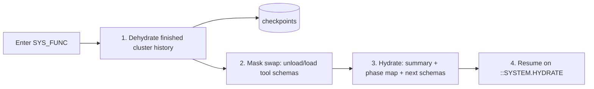

# 011 — Token Optimization Runtime & Observability

> Status: **Detailed**
> Relates to: [DETAILED_DESIGN_PLAN.md](../DETAILED_DESIGN_PLAN.md) §§7, 15 (E3) · Roadmap Wave 1
> Code today: SYS_FUNC / State 0 are **authoring-only**; `run_events.tokensIn/tokensOut/latencyMs` and `runs.tokenUsageJson` are never written
> Depends on: [003](003-live-executors.md) · Related: [002](002-memory-and-code-index.md) · Implement with: **ship-feature** (Composer/Grok)

---

## What

Make the token strategy real at runtime: State 0 phase-map hydration, SYSTEM_FUNCTION dehydrate/mask/hydrate checkpoints, a per-run token ledger with budget enforcement, and a cost heatmap on the canvas.

## Why

"Flat token cost at any FSM depth" is the project's core technical claim, and right now it is only drawn on a canvas — the mask and checkpoint config are authored, linted, and exported, but nothing consumes them during a run. Without the ledger there is also no way to prove the claim: the columns meant to hold the evidence are always null. Once [003](003-live-executors.md) makes real calls, every call is unmeasured and unbounded spend until this lands.

## How

### State 0 hydration (design plan §7.1)

Before the first AI state, the supervisor builds a **phase map** — cluster labels, one-line descriptions, state counts, and (when [002](002-memory-and-code-index.md) is present) a code-index table of contents. No tool schemas, no system prompts. Hard cap **400 tokens**; overflow drops the lowest-priority clusters and appends `+N more clusters`.

```ts
// apps/web/src/lib/context/phase-map.ts
export interface PhaseMap { clusters: { id: string; label: string; summary: string; stateCount: number }[];
                            memoryToc?: string; estimatedTokens: number }
export function buildPhaseMap(dsl: FsmDsl, memo?: MemoryToc, budget = 400): PhaseMap;
```

### SYSTEM_FUNCTION checkpoint boundary (design plan §7.2)



Summary strategies: **`template`** (deterministic — first/last N messages plus extracted variables, zero cost, **default** per Q11) and **`llm`** (cheap model, output hard-capped at 500 tokens, opt-in per SYS_FUNC node).

Checkpoints persist rather than living in Redis for v1 — one fewer service, and it makes replay (E1) free:

```ts
checkpoints: { id, runId, stateId, key: string /* run:{runId}:cp:{n} */,
               summary: text, historyJson: text, tokensSaved: integer,
               createdAt, expiresAt /* default now + 24h */ }
```

### Token ledger

```ts
// apps/web/src/lib/context/ledger.ts
export interface StateUsage { stateId: string; calls: number; tokensIn: number; tokensOut: number;
                              latencyMsP50: number; costUsd?: number }
export interface RunLedger { runId: number; totals: StateUsage; byState: Record<string, StateUsage>;
                             budget?: TokenBudget; breached: boolean }
```

- Counting: provider-billed usage when returned (truth); `tiktoken` estimate as fallback, flagged `estimated: true`.
- Written incrementally onto each `state.output` event, aggregated into `runs.tokenUsageJson` at completion.
- Prices come from a static `model-pricing.ts` table; unknown models report tokens without cost rather than guessing.

### Budget enforcement (Q12 → default **halt**)

`guardrails.tokenBudget` per state and per run. On breach: `halt` (default) emits `::SYSTEM.BUDGET_EXCEEDED` and fails the run; `degrade` retries once on the project's fallback model; `notify` continues and raises a notification ([008](008-notifications.md)). Configured per project with a per-node override.

### Observability

Structured logs (`runId`, `stateId`, `kind`, `durationMs`, never key material) and an optional OTLP exporter behind `OTEL_EXPORTER_OTLP_ENDPOINT` — spans per state, matching the exported-harness story (E6).

## UI implications

| Surface | Change |
|---------|--------|
| [`fsm-canvas.tsx`](../apps/web/src/components/canvas/fsm-canvas.tsx) | Cost heatmap overlay (toggle in the toolbar): node tint by share of run tokens, tooltip with in/out/latency |
| [`runs-view.tsx`](../apps/web/src/components/runs/runs-view.tsx) | Ledger panel — totals, per-state table, budget bar with breach state |
| [`inspector-cards.tsx`](../apps/web/src/components/inspector/inspector-cards.tsx) | Budget + `onExceed` fields on the guardrails card; summary strategy selector on SYS_FUNC |
| New `checkpoint-drawer.tsx` | Inspect a checkpoint's summary and what the mask swapped, per SYS_FUNC hit |

## File / API change map

| Phase | Touch | Change |
|-------|-------|--------|
| T1 | `src/lib/context/phase-map.ts` (new) | Phase-map builder with token cap |
| T1 | `src/lib/run-supervisor.ts` | Inject the phase map before the first AI state |
| T2 | `src/lib/context/checkpoint.ts` (new) | Dehydrate / mask swap / hydrate; `template` + `llm` summarizers (`checkpoints` already in SB0) |
| T2 | `packages/fsm-engine/src/mask.ts` | Expose the runtime tool-schema swap the supervisor calls |
| T3 | `src/lib/context/ledger.ts`, `src/lib/context/model-pricing.ts` (new) | Accumulate usage, cost table, `estimated` flag |
| T3 | `src/lib/executors/ai.ts` | Report billed usage into the ledger |
| T3 | `src/lib/context/budget.ts` (new) | `halt` / `degrade` / `notify` enforcement |
| T4 | `src/components/canvas/cost-overlay.tsx` (new), `canvas-toolbar.tsx` | Heatmap toggle + rendering |
| T4 | `src/components/runs/ledger-panel.tsx` (new) | Totals, per-state table, budget bar |
| T5 | `src/lib/telemetry.ts` (new) | Structured logs + optional OTLP spans |

## Edge cases & failure modes

| Case | Expected behavior |
|------|-------------------|
| Provider omits usage | Fall back to `tiktoken`; mark `estimated: true` in the ledger and UI |
| Unknown model in the price table | Report tokens, omit cost; never estimate a price |
| Phase map exceeds 400 tokens | Drop lowest-priority clusters, append `+N more clusters`; never silently truncate mid-cluster |
| `llm` summary call fails | Fall back to `template`, emit a warning event; the run continues |
| Budget breached mid-stream | Abort the in-flight call at the chunk boundary; partial output is stored with the breach reason |
| `degrade` with no fallback model | Behaves as `halt` and says so in the event message |
| Checkpoint > 1 MiB | Store the summary, spill `historyJson` to a `chunkRef` pointer, count it in `tokensSaved` |
| Checkpoint TTL expired on replay | Replay degrades to summary-only and labels itself lossy |
| Run cancelled | Ledger is finalized with what was recorded; no orphaned `running` totals |
| Concurrent SPAWN children | Child usage aggregates into the parent state's row, not a phantom state |

## Open questions

1. Should the ledger be a materialized table for cross-run analytics, or stay derived from `run_events`?
2. Per-key spend caps (Q16) here, or in [005](005-credential-security.md)'s credential lifecycle?

## Implementation phases

| Phase | Scope | Size |
|-------|-------|------|
| T1 | Phase map + State 0 injection | 1 PR |
| T2 | Dehydrate / mask / hydrate (`checkpoints` already in SB0) | 1 PR |
| T3 | Ledger + pricing + budget enforcement | 1 PR |
| T4 | Cost heatmap + ledger panel | 1 PR |
| T5 | Structured logs + optional OTLP | 1 PR |

## Test plan

**Vitest** — `src/lib/context/*.test.ts`

- `buildPhaseMap` stays at or under the 400-token cap for a 200-state fixture and appends the `+N more clusters` marker.
- Phase map contains no tool schema or system-prompt text (assert against known fixture strings).
- `template` summarizer is deterministic and preserves extracted variables across two identical inputs.
- `llm` summarizer output is truncated at 500 tokens; a thrown provider error falls back to `template`.
- Dehydrate → hydrate round-trips the finished-cluster history and reports `tokensSaved > 0`.
- Mask swap unloads the finished cluster's schemas and loads exactly the next cluster's.
- **Ledger invariant (design plan §7.2):** across a 3-cluster golden fixture, prefill tokens for the AI state after each SYS_FUNC stay under budget and do **not** grow with FSM depth.
- Ledger prefers billed usage over the estimate; sets `estimated: true` only when usage is absent.
- Unknown model yields tokens with `costUsd: undefined`.
- Budget `halt` emits `::SYSTEM.BUDGET_EXCEEDED` and marks the run failed.
- Budget `degrade` retries on the fallback model once; with no fallback configured it halts.
- Budget `notify` completes the run and raises exactly one notification.
- Per-state aggregation sums SPAWN child usage into the parent state.

**Playwright** — `e2e/token-ledger.spec.ts` (`FSM_MOCK_PROVIDER=1`, fixed mock token counts)

- Run a 2-AI-state FSM → the ledger panel shows non-zero in/out totals matching the mock counts.
- Toggle the heatmap → the higher-cost node renders a stronger tint and its tooltip shows tokens and latency.
- Set a run budget below the mock cost → the run halts with a visible budget-exceeded message.
- Open the checkpoint drawer after a SYS_FUNC hit → the summary and swapped schema list are shown.

## Acceptance criteria

- [ ] Every AI call records `tokensIn`, `tokensOut`, and `latencyMs` on its `state.output` event.
- [ ] `runs.tokenUsageJson` holds the finalized ledger at completion.
- [ ] SYS_FUNC nodes perform a real dehydrate → mask swap → hydrate at runtime.
- [ ] The depth-invariance test proves prefill does not grow with FSM depth.
- [ ] Budget breaches are enforced per the configured `onExceed` mode.
- [ ] The canvas heatmap reflects real per-state cost.
- [ ] Vitest and Playwright suites above pass in CI.
