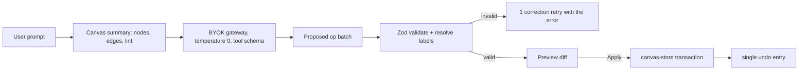

# 012 — AI Copilot

> Status: **Detailed**
> Relates to: [DETAILED_DESIGN_PLAN.md](../DETAILED_DESIGN_PLAN.md) §10.4, P9 · Roadmap Wave 4
> Code today: [`copilot-panel.tsx`](../apps/web/src/components/copilot/copilot-panel.tsx) — regex keyword matching, random node placement, self-labelled "online · stub mode"
> Depends on: [003](003-live-executors.md) (gateway) · Implement with: **ship-feature** (Composer/Grok)

---

## What

Replace the keyword-matching stub with a real tool-calling copilot: the model proposes canvas operations, every operation is Zod-validated before it touches the store, and every applied batch is undoable as one unit.

## Why

The panel currently understands about four hard-coded phrases and drops new nodes at random coordinates. It advertises itself as "stub mode", which is honest but means the fourth product promise — visual authoring with an AI copilot — is unmet. The infrastructure it needs is already built by then: [003](003-live-executors.md) ships the BYOK gateway with streaming and a mock adapter, so the copilot is mostly a schema and a reducer, not new plumbing.

The risk to manage is non-determinism corrupting a user's canvas. The mitigation is structural: the model never writes to the store, it only proposes ops that must pass validation.

## How

### Operation schema (design plan P9)

Lives in a new `packages/fsm-schema` so the export engine and future SDK can reuse it:

```ts
// packages/fsm-schema/src/copilot-ops.ts
export const CopilotOp = z.discriminatedUnion("op", [
  z.object({ op: z.literal("add_node"), stateType: FSMStateTypeSchema,
             label: z.string().max(60), position: z.object({ x: z.number(), y: z.number() }).optional() }),
  z.object({ op: z.literal("connect"), sourceLabel: z.string(), targetLabel: z.string(),
             signal: SignalSchema.optional(), kind: EdgeKindSchema.optional() }),
  z.object({ op: z.literal("set_config"), nodeLabel: z.string(), patch: z.record(z.unknown()) }),
  z.object({ op: z.literal("delete_node"), nodeLabel: z.string() }),
  z.object({ op: z.literal("rename_node"), nodeLabel: z.string(), newLabel: z.string().max(60) }),
  z.object({ op: z.literal("explain"), text: z.string().max(2000) }),
]);
export type CopilotOp = z.infer<typeof CopilotOp>;
```

Ops address nodes by **label**, not id — labels are what the model can see in the prompt, and the reducer resolves them to ids (rejecting ambiguous matches).

### Loop



- **Temperature 0** and a canvas summary capped at ~1500 tokens (labels, types, edges, current lint codes — never full script bodies).
- **One correction retry**: an invalid batch is sent back with the Zod error; a second failure surfaces "I couldn't produce a valid edit" rather than partially applying.
- **Preview before apply** for destructive batches (any `delete_node`, or more than five ops); additive single ops apply directly with an undo toast.
- **Atomic apply**: the reducer applies the whole batch or none of it, pushing one entry onto an undo stack (`Ctrl+Z` reverts the whole batch).
- **Auto-layout**: new nodes are placed by a deterministic layout helper — to the right of their most likely predecessor with collision avoidance — replacing `Math.random()` (which is also one of the CI2 lint errors in [006](006-ci-pipeline.md)).

The copilot uses the user's own BYOK credential (Q22), selected in the panel; with no credential configured, the panel explains what to add rather than failing silently.

## UI implications

| Surface | Change |
|---------|--------|
| [`copilot-panel.tsx`](../apps/web/src/components/copilot/copilot-panel.tsx) | Real streaming replies, credential/model picker, "stub mode" indicator removed |
| New `op-preview.tsx` | Diff card listing each op with Apply / Discard |
| [`canvas-toolbar.tsx`](../apps/web/src/components/canvas/canvas-toolbar.tsx) | Undo/redo reflecting copilot batches alongside manual edits |

## File / API change map

| Phase | Touch | Change |
|-------|-------|--------|
| CP1 | `packages/fsm-schema/` (new) | `copilot-ops.ts`, shared signal/state-type schemas extracted from `fsm-types.ts` |
| CP1 | `src/lib/copilot/reducer.ts` (new) | Label resolution, atomic batch apply, undo entry construction |
| CP1 | `src/lib/copilot/layout.ts` (new) | Deterministic placement replacing random coordinates |
| CP2 | `src/lib/copilot/prompt.ts` (new) | Canvas summarizer with a token cap + tool-schema prompt |
| CP2 | `src/app/api/copilot/route.ts` (new) | Streaming tool-call loop over `packages/byok-gateway` |
| CP2 | `src/components/copilot/copilot-panel.tsx` | Replace regex handling with the real loop |
| CP3 | `src/components/copilot/op-preview.tsx` (new) | Preview/apply/discard for destructive batches |
| CP3 | `src/stores/canvas-store.ts` | Transactional batch apply + undo stack |

## Edge cases & failure modes

| Case | Expected behavior |
|------|-------------------|
| Model returns prose instead of ops | Treated as an `explain` op; the canvas is untouched |
| Invalid op shape | One correction retry, then a plain "couldn't produce a valid edit" message |
| Op references a non-existent label | Rejected with a suggestion of the closest label; batch not applied |
| Ambiguous label (two nodes share it) | Rejected asking the user to disambiguate; never guesses |
| Batch would create a lint error | Applied, but the preview warns and the lint panel highlights it (authors may build in stages) |
| Batch tries to delete every node | Requires explicit preview confirmation regardless of size thresholds |
| No credential configured | Panel explains how to add one; no request is sent |
| Provider error or rate limit | Message surfaces the error; the canvas is untouched |
| Stream interrupted mid-batch | Nothing applies — ops are parsed only after the stream completes |
| Very large canvas | Summary is capped; the model is told the canvas was truncated |
| Undo after apply | Restores the exact prior state, including edges and positions |

## Open questions

1. Should the copilot be allowed to author script bodies, or only structure and config in v1?
2. Multi-turn planning ("build me a scraper") — one big batch, or a guided sequence of confirmations?

## Implementation phases

| Phase | Scope | Size |
|-------|-------|------|
| CP1 | `fsm-schema` package + op reducer + deterministic layout | 1 PR |
| CP2 | Prompt builder + streaming tool-call route + panel rewrite | 1 PR |
| CP3 | Preview/apply UX + transactional undo | 1 PR |

## Test plan

**Vitest** — `packages/fsm-schema/src/copilot-ops.test.ts`, `apps/web/src/lib/copilot/*.test.ts`

- Every op variant parses; unknown `op` values and malformed payloads are rejected with a field path.
- `add_node` rejects labels over 60 characters and unknown state types.
- Reducer resolves labels to ids and rejects unknown labels with a nearest-match suggestion.
- Reducer rejects an ambiguous label matching two nodes.
- Batch application is atomic: a batch whose third op is invalid leaves the store untouched.
- One undo entry reverts a five-op batch completely, including edges and positions.
- Layout helper is deterministic — identical canvases produce identical coordinates — and never overlaps an existing node.
- Canvas summarizer stays under the token cap for a 200-node canvas and excludes script bodies (asserted against a fixture secret string).
- A prose-only model reply becomes an `explain` op with no store mutation.
- An invalid batch triggers exactly one correction retry, then gives up without applying.

**Playwright** — `e2e/copilot.spec.ts` (`FSM_MOCK_PROVIDER=1` returning a scripted op batch)

- "Add an HTTP state and connect it to END" → both nodes appear, wired, with no overlap.
- Undo → the canvas returns to its prior state.
- A batch containing a delete shows the preview; Discard leaves the canvas unchanged.
- With no credential configured, the panel shows the setup hint and issues no request.
- The panel no longer displays "stub mode".

## Acceptance criteria

- [ ] The copilot mutates the canvas only through Zod-validated ops.
- [ ] Batches apply atomically and revert with a single undo.
- [ ] Node placement is deterministic; `Math.random()` is gone from the panel.
- [ ] The copilot runs on the user's BYOK credential and streams replies.
- [ ] Invalid model output never corrupts the canvas.
- [ ] Vitest and Playwright suites above pass in CI.
