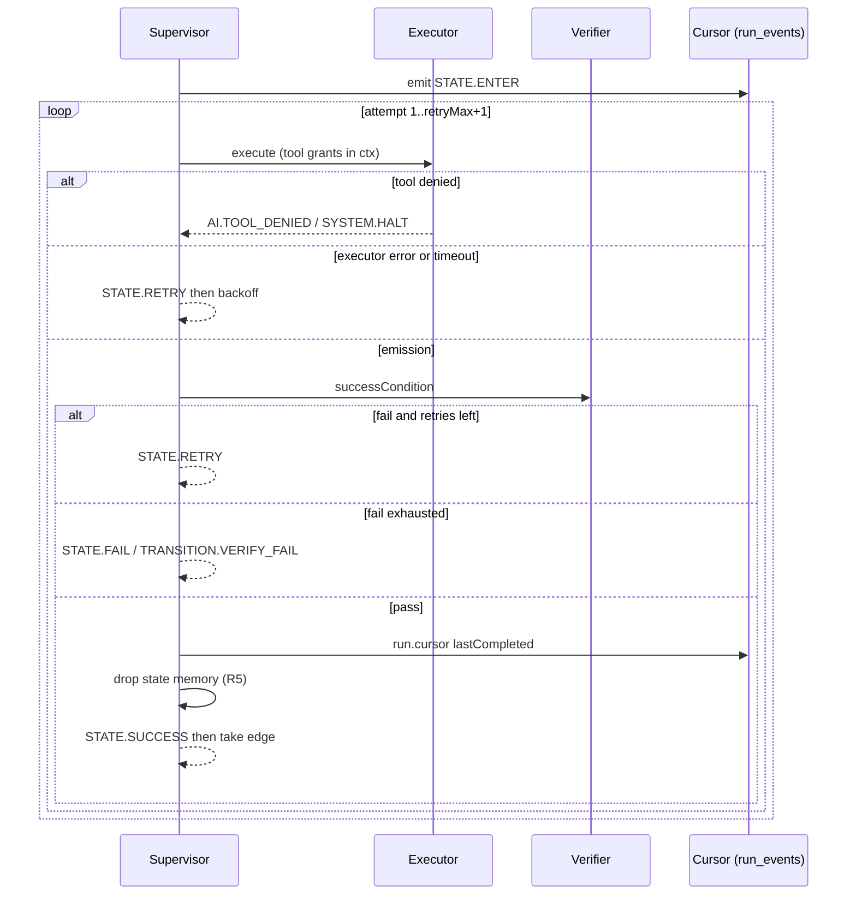

# 014 — Run Contract: Retry, Verify, Resume, Tool Grants, Per-State Memory

> Status: **Detailed**
> Relates to: [013](013-state-signal-catalog.md), [003](003-live-executors.md), [011](011-token-and-observability.md), [DETAILED_DESIGN_PLAN.md](../DETAILED_DESIGN_PLAN.md) §§6.2, 6.4, 7
> Code today: [`packages/fsm-engine/src/run-state.ts`](../packages/fsm-engine/src/run-state.ts) already retries on timeout/execute/output-schema; inspector `guardrails.retryMax`; HUMAN pause is 003 E3; SYS_FUNC dehydrate is 011 T2
> Depends on: 013 F1 (signal kits + `SuccessCondition` types) · 003 E1 supervisor · Implement with: **ship-feature** then **test-feature**
> Do not edit `schema.ts` — persist cursor as `run_events` (kind `run.cursor`)

---

## What

Five runtime guarantees that make states independently executable:

| Id | Guarantee |
|----|-----------|
| **R1** | Per-state retry is honored, emitted as `::STATE.RETRY`, distinct from self-loop caps |
| **R2** | A state may not transition until its **success condition** passes; optional **high-end model verifier** |
| **R3** | Last completed state + payload + attempt are persisted so a crashed run resumes without re-doing finished work |
| **R4** | Tools are allowlisted per state; a denied call issues a capability-token miss, signals the AI, and **stops** that turn |
| **R5** | After a state succeeds, that state’s conversational/tool memory is dropped; the next state starts clean |

## Why

Authoring already has `retryMax`, `inputSchema`/`outputSchema`, and SYS_FUNC checkpoints, but:

- Retries are silent (no `::STATE.RETRY` / `state.retry` for authors or the AI).
- “Success” is whatever the executor emitted — no independent gate, no judge model.
- `interrupted` runs do not restart at the next state; HUMAN is the only park/resume path.
- Tool packs exist on SPAWN children, not on ordinary AI/SCRIPT states; a model can call anything in the cluster mask.
- SYS_FUNC clears memory at **cluster** boundaries; states inside a cluster still share history, so a later AI state sees prior chain-of-thought.

## How



### R1 — Per-state retry

`GuardrailConfig` already has `timeoutMs`, `retryMax`, `retryBackoffMs`. Extend:

```ts
export type RetryReason = "timeout" | "execute" | "output_schema" | "verify_fail" | "tool_denied";

export interface GuardrailConfig {
  timeoutMs: number;
  retryMax: number;          // extra attempts after the first; 0 = no retry
  retryBackoffMs: number;    // exponential: backoff * 2^(attempt-1), cap 30s
  retryOn: RetryReason[];    // default ["timeout","execute","output_schema"]
}
```

Rules:

- Self-loop `maxIterations` is **not** a retry. Do not increment retry counters on a taken self-loop.
- HUMAN / START / END / SYSTEM_FUNCTION / SPAWN / AGGREGATE: `retryMax` ignored (lint warning `RETRY_IGNORED_ON_TYPE`). HUMAN timeout uses `HumanConfig.onTimeout`.
- Each retry emits `run_events.kind = "state.retry"` **and** parsed signal `::STATE.RETRY|attempt=N|reason=timeout`.
- Exhausted retries emit the state’s failure kit signal (`STATE_SIGNAL_KITS[type].failure`) and follow that edge if present, else halt.

Engine: extend [`run-state.ts`](../packages/fsm-engine/src/run-state.ts) with `retryOn` and an `onRetry` callback. Supervisor maps callback → events.

### R2 — Success condition + high-end verifier

After a successful executor return (before `resolveTransition`):

1. If `successCondition.kind === "signal"` (default): the emission’s signal must equal the state’s success kit **or** an authored outgoing edge. If it already does, pass.
2. `schema`: Ajv validate `emission.payload` (fallback whole emission). Fail → `verify_fail`.
3. `predicate`: evaluate JSONLogic `expr` with data `{ payload, signal, stateId }`. Fail → `verify_fail`.
4. `llm_verify`: call BYOK with the **judge** `credentialId`/`modelId` (must differ from the worker model when the state is AI — lint `VERIFY_SAME_MODEL` warning, still allowed). Prompt = rubric + truncated payload (cap 4k tokens). JSON mode `{ pass: boolean, reason: string }`. `FSM_MOCK_PROVIDER=1` returns `{ pass: true }` unless payload contains `"VERIFY_FAIL"`.

Fail path: if `retryOn` includes `verify_fail` and attempts remain → R1; else emit `::TRANSITION.VERIFY_FAIL` and `::STATE.FAIL`. If `onFail === "error_signal"` (llm_verify) skip retry and go straight to failure signal.

Verifier is a **pure module** [`apps/web/src/lib/verify-success.ts`](../apps/web/src/lib/verify-success.ts) so tests do not need the supervisor.

### R3 — Resumability cursor

Not a new table. Append-only event:

```ts
// run_events.kind = "run.cursor"
{
  lastCompletedStateId: string;
  lastSignal: string;
  nextStateId: string;      // resolver target after last success
  attempt: number;
  payloadRef: string;       // hash or inline JSON ≤ 64KiB; larger → checkpoint row if 011 exists
  updatedAt: string;
}
```

On `state.output` + verifier pass, write cursor **before** entering the next state.

Resume:

| Run status at boot / user Resume | Action |
|----------------------------------|--------|
| `awaiting_human` | Existing 003 E3 path |
| `interrupted` / `running` recovered after crash | Load latest `run.cursor`; set current = `nextStateId`; do **not** re-execute `lastCompletedStateId` |
| `pending` / `cancelled` / `succeeded` / `failed` | No auto-resume |
| Cursor missing | Restart from START (emit `run.resume_without_cursor` warning) |

API: `POST /api/runs/[runId]/resume` (idempotent if already running).

Distinct from 011 checkpoints: checkpoints shrink **tokens**; the cursor records **progress**. Both can coexist. R5 still drops memory; cursor payload is the **output** of the last state only.

### R4 — Tool access + stop signal

Per-state allowlist on `StateNodeData`:

```ts
export interface ToolAccess {
  mode: "inherit" | "allowlist" | "deny_all";
  allow: string[];          // tool names / HTTP ids
  // deny wins if a name is in both inherit mask and allow
}

export interface ToolGrant {
  token: string;            // HMAC-SHA256(PLATFORM_SECRET, runId|stateId|toolName|exp)
  toolName: string;
  runId: number;
  stateId: string;
  exp: number;              // now + guardrails.timeoutMs + 5s
}
```

- `inherit` (default): tools enabled by the active SYS_FUNC mask (011 T2) ∪ the state’s own SCRIPT/HTTP config.
- `allowlist`: intersection of inherit and `allow`. Empty allowlist ≡ no tools.
- `deny_all`: no tools, including the state’s own SCRIPT tool (lint error unless type is AI/VALIDATE/HUMAN).

Before SCRIPT/HTTP/gRPC execute, mint a grant. The bridge/executor checks HMAC + exp + name. Missing/invalid grant → do not run the tool.

When an **AI** state requests a tool not in the grant set:

1. Do **not** execute the tool.
2. Append a tool-result message: `TOOL_DENIED tool=X reason=not_in_allowlist`.
3. Emit `::AI.TOOL_DENIED` as a `run_events` signal.
4. **Stop the AI turn** — no further model tokens on this attempt.
5. If `retryOn` includes `tool_denied` and attempts remain → R1 with that reason; else fail the state with `::AI.TOOL_DENIED` (failure kit extra). Do not continue the graph on a hidden skip.

Q35 **locked**: denied tool ⇒ stop, not “tell the model and keep chatting”.

### R5 — Per-state memory drop

States are independent. After R2 pass and cursor write:

```ts
export interface RunContext {
  vars: Record<string, unknown>;     // extracted outputs, kept
  payload: unknown;                  // last state's output only
  history: ChatMessage[];            // wiped per Work/Generative state
  toolLogs: string[];                // wiped
  phaseMap?: PhaseMap;               // kept (State 0, 011 T1)
  ledger: RunLedger;                 // kept
}
```

| Type | After success |
|------|----------------|
| SCRIPT HTTP VALIDATE AI EXTERNAL_AI HUMAN custom | `history = []`, `toolLogs = []`; keep `payload` + `vars[stateId]` |
| START | Keep phase map; no history yet |
| SYSTEM_FUNCTION | Existing 011 dehydrate/hydrate **wins** (cluster summary replaces history) |
| SPAWN / AGGREGATE | Keep aggregate envelope in `vars`; drop child transcripts |

`retainContext: true` on a node (opt-in, default **false**) skips the wipe for that state only. Lint warning `RETAIN_CONTEXT_COST` on AI nodes.

Next AI state prompt = systemPrompt + phaseMap (once) + **current payload** + tool schemas for the grant set. Not the previous state’s chain-of-thought.

---

## UI implications

| Surface | Change |
|---------|--------|
| Inspector Guardrails | `retryOn` multi-select; show “retries ≠ self-loop” helper |
| Inspector Success | Already 013 F2; R2 adds a “Test condition” button (dry-run against last payload, mock judge) |
| Inspector Tools | Allowlist editor (names from SCRIPT tool + HTTP label + Describe registry when 010 is up) |
| Inspector Context | `retainContext` checkbox |
| Runs view | Retry events in the log; Resume button on `interrupted`; “tool denied” chip; cursor line “last completed: S2” |

---

## File / API change map

| Phase | Touch | Change |
|-------|-------|--------|
| **R1** | `packages/fsm-engine/src/run-state.ts`, `signals.ts`, `runner.ts` | `retryOn`, `onRetry`, emit STATE.RETRY; backoff exponential |
| **R1** | `apps/web/src/lib/executors/*` or supervisor | Map engine retries to `state.retry` events (rebase onto E3/T2; **one** agent owns `run-supervisor.ts`) |
| **R2** | `apps/web/src/lib/verify-success.ts` (new) | schema / predicate / llm_verify; mock provider hook |
| **R2** | supervisor | Call verifier before `resolveTransition` |
| **R3** | `apps/web/src/lib/run-cursor.ts` (new) | serialize/parse cursor from events |
| **R3** | `apps/web/src/app/api/runs/[runId]/resume/route.ts` (new) | Resume from cursor |
| **R3** | supervisor boot | `interrupted` → resume `nextStateId` |
| **R4** | `apps/web/src/lib/tool-grants.ts` (new) | HMAC mint/verify |
| **R4** | AI executor + SCRIPT executor | Inject grants; on miss emit TOOL_DENIED and stop |
| **R5** | `apps/web/src/lib/run-context.ts` (new) | `dropStateMemory(ctx, state)` |
| **R5** | supervisor | Call drop after cursor write |

Hot file: `run-supervisor.ts` — **single lane** (Lane R). R1–R5 after the first may stack on the same branch if one agent ships them sequentially; parallel PRs must not both edit the supervisor.

No `schema.ts` edits. Payload overflow uses 011 `checkpoints` when that table exists; otherwise truncate to 64KiB with `CURSOR_PAYLOAD_TRUNCATED`.

---

## Edge cases & failure modes

| Case | Behavior |
|------|----------|
| `retryMax: 0` | Single attempt; no `STATE.RETRY` |
| Verifier throws / judge 5xx | Treat as `verify_fail` (fail closed) |
| Judge returns non-JSON | `verify_fail` |
| Resume while status `running` | 409 `ALREADY_RUNNING` |
| Cursor `nextStateId` missing from DSL (version drift) | Fail `CURSOR_STATE_MISSING`; do not guess START |
| Grant expired mid-stream | Deny; same TOOL_DENIED path |
| AI requests 3 illegal tools in one turn | Stop on the **first**; do not batch |
| `retainContext` + SYS_FUNC next | SYS_FUNC dehydrate still runs; retain only affects the wipe at the end of the retaining state |
| R5 drop then resume | Cursor payload is enough to enter next state; history stays empty |

---

## Open questions

None — locked in [000](000-completion-roadmap.md) §6 (Q35–Q40).

---

## Suggested implementation phases

| Phase | Scope | Owns supervisor? |
|-------|-------|------------------|
| **R1** | Engine retryOn + STATE.RETRY + supervisor event mapping | Yes (after types from 013 F1) |
| **R2** | `verify-success.ts` + supervisor hook | Yes |
| **R3** | Cursor events + resume route + boot | Yes |
| **R4** | Grants + AI stop on deny | Yes |
| **R5** | `dropStateMemory` + supervisor hook | Yes |

**Parallel start (no supervisor):** R2/R4/R5 **libraries + Vitest only** may land as one greenfield PR (`verify-success`, `tool-grants`, `run-context`, `run-cursor`) from any base. Wiring PRs then stay small.

Recommended first ship: **libs PR** (R2+R4+R5+R3 parsers) then **R1 engine**, then **one supervisor PR** that wires all five.

---

## Test plan

### Vitest

- R1: timeout retries 2 times then failure signal; `retryOn` without `timeout` does not retry timeouts; self-loop does not consume retry budget.
- R2: schema pass/fail; JSONLogic predicate; mock llm_verify pass; payload `"VERIFY_FAIL"` → fail; throw → fail closed.
- R3: cursor round-trip from event list; resume skips `lastCompletedStateId`; missing cursor → START + warning flag.
- R4: mint/verify HMAC; expired token fails; AI denied path returns `::AI.TOOL_DENIED` and does not call the tool; allowlist empty denies all.
- R5: after drop, `history` is `[]` and `vars[stateId]` remains; `retainContext` keeps history; SYS_FUNC path not wiped by R5 helper (caller skips).

### Playwright (`FSM_MOCK_PROVIDER=1`)

- R1: HTTP state with retryMax 1 + mock 500 then 200 → log shows one `state.retry` → success.
- R2: VALIDATE-like schema condition fail routes to error node.
- R3: kill is hard to E2E; instead: run to HUMAN, approve, assert cursor line updates; refresh resume stays parked until approve (existing E3) plus a fixture that POSTs resume on an `interrupted` row.
- R4: AI state allowlist empty → run fails with tool denied chip, not a silent success.
- R5: two AI states in sequence; second prompt fixture (mock adapter) must not include the first state’s assistant text.

---

## Acceptance criteria

- [ ] Per-state `retryOn` is authored and fires `::STATE.RETRY`.
- [ ] Transition is blocked until success condition passes; llm_verify uses a judge model.
- [ ] Interrupted runs resume at `nextStateId` with last payload only.
- [ ] Disallowed tools never execute; AI turn stops with `::AI.TOOL_DENIED`.
- [ ] Default Work/Generative states clear history after success.
- [ ] No `schema.ts` change.
- [ ] Named tests above are green.
